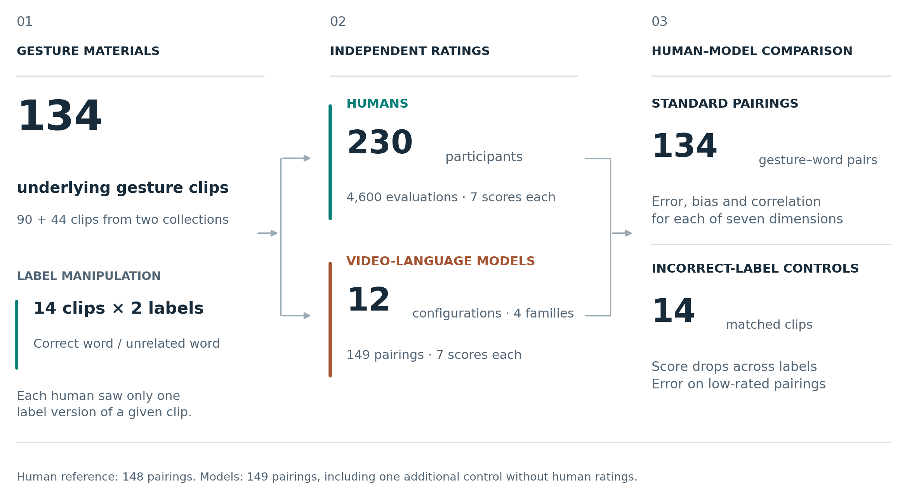
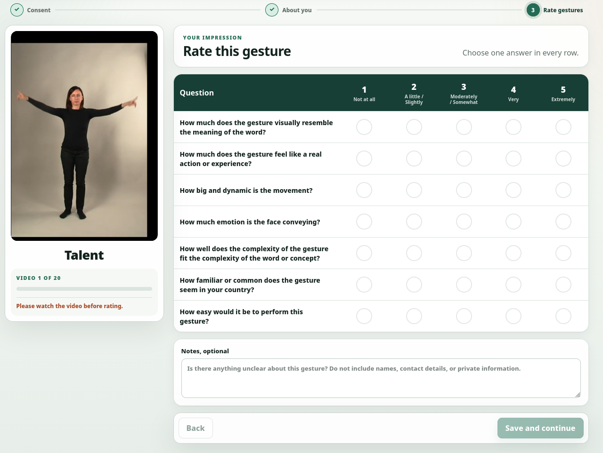
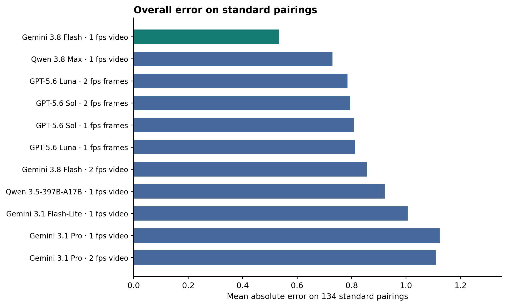
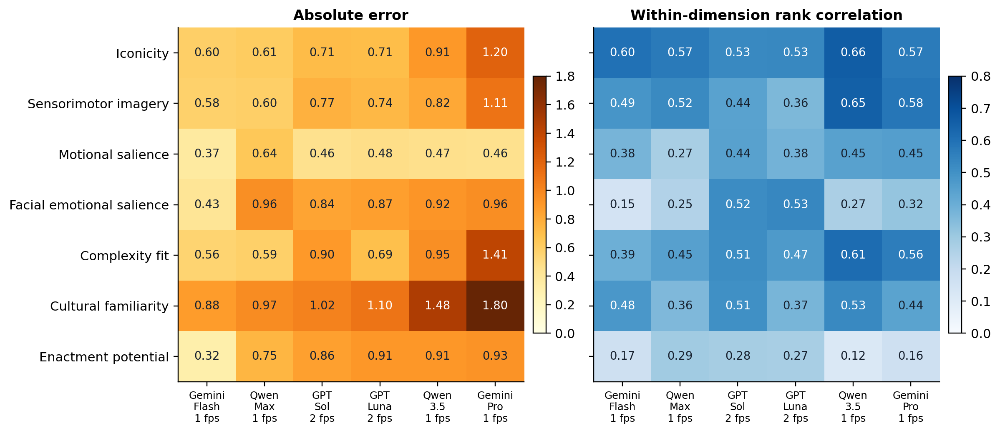
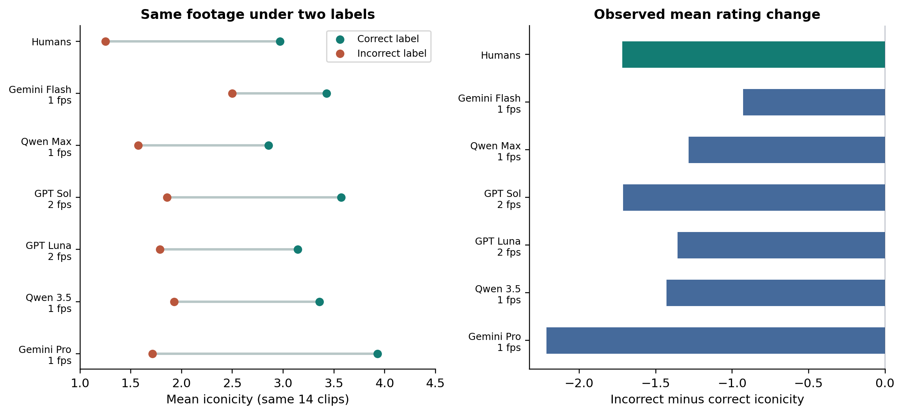

# Can Video-Language Models Rate Instructional Gestures Like Humans Do? A Benchmark Study

Manuela Macedonia1*, Samer Salama2*, Javier Conde2, Claudia Repetto3, Brian Mathias4,

Christian Andrä5, Kazuki Sekine6, and Pedro Reviriego2

1Department for Information Engineering, Johannes Kepler University Linz, Linz, Austria

2Information Processing and Telecommunications Center (IPTC), Universidad Politécnica de Madrid, Madrid, Spain

3Department of Psychology, Catholic University of Milan, Milan, Italy

4School of Psychology, University of Aberdeen, Aberdeen, United Kingdom

5Department Sports Didactics, University of Potsdam, Potsdam, Germany

6Faculty of Human Sciences, Waseda University, Tokyo, Japan

*Co-first authors. Emails: manuela.macedonia@jku.at, samer.salama@upm.es

## Abstract

Systematic characterization of instructional gestures is essential for vocabulary-learning research, yet manual human annotation is labor-intensive and costly to scale. Video-language models (VLMs) may support this process, yet their correspondence with human judgment requires empirical evaluation. We benchmarked twelve configurations from four model families (Google Gemini, OpenAI GPT, Alibaba Qwen, Elorian Glimpse) against 230 human raters across four language cohorts, who rated 148 instructional gesture–word pairings derived from 134 underlying clips on seven dimensions drawn from the Gesture Memory Support Model. Mean absolute error across configurations ranged from 0.53 to 1.12 points on five-point scales, and pooled rank correlations ranged from .62 to .69. Crucially, error and rank-order agreement dissociated: dimensions with the lowest error (enactment potential, motional salience) had the weakest rank correlations, while iconicity showed the opposite pattern. This dissociation mirrored a structural feature of the human data itself, where the same two dimensions showed the lowest interrater reliability and the most compressed rating distributions. Models rated mismatched gesture–word pairs lower than matched pairs, indicating genuine sensitivity to semantic compatibility, though residual ratings remained above the human floor. Cultural familiarity showed the largest model–human discrepancies; independently, human ratings on this and related dimensions varied systematically by language cohort even after controlling for item identity, indicating that the human reference itself is not culturally neutral. These findings support selective, dimension-specific use of VLMs for gesture annotation under human oversight, rather than uniform deployment across the full rating profile. The benchmark establishes descriptive correspondence with human judgment; it does not establish whether model- or human-derived ratings predict empirical vocabulary-learning outcomes, which remains an open question for future intervention studies.

Introduction

Gesture has long been recognized as a powerful facilitator of language learning and memory. In second language (L2) acquisition research, a substantial body of behavioral, cognitive, and neuroscientific evidence has demonstrated that gestures enrich lexical encoding, strengthen semantic associations, and improve long-term retention (Macedonia, 2025). Instructional gestures, movements deliberately paired with words, may depict a word’s meaning, such as raising an imaginary cup to the mouth when learning the L2 word for “to drink,” or establish an arbitrary association with it; mnemonic benefits have been shown for both concrete and abstract vocabulary (Macedonia & Knösche, 2011). From a neuroscientific perspective, gesture-supported learning engages distributed neural networks linking word representations with sensory and motor information (Macedonia et al., 2011; Macedonia & Mueller, 2016; Macedonia et al., 2019; Mayer et al., 2017), consistent with broader theories of embodied cognition proposing that conceptual knowledge is grounded in sensorimotor experience (Barsalou, 2008). A recent three-level meta-analysis of 52 studies and 442 effect sizes further supports the educational relevance of embodied vocabulary instruction (X. Li et al., 2026).

The magnitude of gesture-related benefits nonetheless varies substantially across studies, learners, and lexical items. This variation arises from multiple coexisting sources: word-level properties (length, concreteness, phonological familiarity), learner-level factors (proficiency, memory capacity, prior knowledge), instructional procedures (training duration, repetition, observation versus enactment), and assessment characteristics. An additional, often underexamined source concerns properties of the gestures themselves: how transparently they represent meaning, how strongly they evoke sensorimotor experience, how perceptually salient they are, and how readily learners can interpret and reproduce them. Treating all gestures as equivalent within a single “gesture-supported” condition obscures this variability; a condition-level comparison can estimate an average benefit but cannot explain why some gesture–word pairings support learning more effectively than others (Macedonia & Klimesch, 2014).

To address this gap, recent work has moved beyond binary “gesture/no-gesture” distinctions toward characterizing gesture effectiveness as a multidimensional construct. Macedonia et al. (2026) have proposed the Gesture Memory Support Model (GMSM), a preliminary theoretical and operational framework distinguishing seven dimensions: iconicity, sensorimotor imagery potential, motional salience, emotional salience fit, gesture complexity fit, cultural familiarity, and enactment potential. These dimensions describe both intrinsic properties of gestures and their fit with target meanings, learner populations, and instructional contexts; ratings are retained as a multidimensional profile rather than collapsed into a single effectiveness score, since a higher rating indicates more of a characteristic rather than necessarily greater mnemonic benefit. Such profiles could serve as item-level covariates in mixed-effects models of vocabulary-learning outcomes, allowing researchers to estimate the contributions of specific gesture characteristics alongside lexical and learner-level variables—though the reliability, empirical distinctiveness, and predictive relevance of these dimensions remain to be established.

A significant methodological bottleneck constrains this purpose: operationalizing gesture-related variables typically requires human annotation of video data, with each gesture rated independently across seven dimensions under clearly defined criteria. This process is time-consuming, costly, and inherently subjective, and inter-rater agreement becomes increasingly difficult to maintain as stimulus sets grow or additional linguistic populations are included. Ratings may also reflect raters’ own linguistic experience and cultural familiarity, meaning that human annotation provides a population-dependent reference rather than an error-free standard. As gesture datasets expand, reliance on manual coding becomes increasingly impractical for large-scale or longitudinal research, creating a clear need for computational methods capable of estimating gesture-related covariates reliably and reproducibly.

The rapid emergence of Vision-Language Models (VLMs) offers a promising avenue for addressing this bottleneck. Advances in multimodal artificial intelligence have produced models capable of jointly processing visual, temporal, and linguistic information, enabling forms of video understanding and semantic reasoning that go beyond earlier pipelines reliant on low-level motion tracking or pose estimation. Extending the existing use of AI-generated psycholinguistic ratings (e.g., word concreteness, familiarity) to gesture stimuli introduces additional demands: models must track movement over time, evaluate relationships between visible actions and intended lexical meaning, and interpret dimensions, such as cultural familiarity, whose relevance may itself vary across contexts. Whether VLMs can meet these demands well enough to generate useful, GMSM-aligned covariates is an open empirical question.

This paper investigates that question directly: whether state-of-the-art VLMs can autonomously estimate GMSM-aligned gesture covariates from instructional video data in correspondence with human judgment. We evaluate zero-shot prompting across model families and input configurations. Because agreement between models alone cannot establish correspondence with human raters, and because an aggregate performance measure may conceal dimension-specific differences, evaluation must distinguish rank-order association, absolute agreement, and systematic bias—distinctions essential for identifying which model-generated ratings are suitable for downstream statistical use and which still require human oversight. More broadly, this work aims to determine whether VLMs can transform qualitative video data into robust, scalable statistical covariates, offering a computational lens onto how embodied, multimodal features shape the formation and durability of lexical representations.

## 2. Theoretical Background

### 2.1 Gesture in Second Language Acquisition

The Gesture Memory Support Model (GMSM; Macedonia et al., 2026) provides a preliminary theoretical framework for characterizing variation among instructional gestures. Drawing on embodied cognition, memory research, and cognitive load theory, it identifies seven dimensions hypothesized to contribute to gesture-supported vocabulary learning. These dimensions describe observable gesture characteristics, distinguishing properties of a stimulus from the cognitive processes it may elicit and the learning outcomes it may support.

The framework is consistent with accounts proposing that conceptual representations involve perceptual and motor systems (Barsalou, 2008; Glenberg & Gallese, 2012; Pulvermüller, 2005). It is also compatible with dual-coding theory, which describes interconnected verbal and nonverbal representations that can provide complementary routes for encoding and retrieval (Paivio, 2007). These accounts motivate the characterization of gesture-related information but do not establish the predictive validity of individual GMSM dimensions. The seven dimensions are therefore retained as a descriptive profile whose relationships with learning require empirical investigation.

### 2.1.1 Iconicity

Iconicity concerns the extent to which a gesture’s form or movement resembles aspects of its intended lexical meaning. For example, outlining a roof with the hands can depict a perceptual feature associated with house, whereas miming drinking can represent an action associated with to drink. Iconicity is thus evaluated for a particular gesture–meaning pairing rather than inferred from a broad gesture category. Different representational strategies can produce similarly transparent relationships between movement and meaning (Dingemanse et al., 2020; Perniss et al., 2010; Perniss & Vigliocco, 2014). Research comparing semantically congruent and incongruent gesture–word pairings supports the importance of this relationship. Congruent gestures can facilitate vocabulary learning, whereas conflicting gestural information can interfere with encoding and semantic processing (Kelly et al., 2010; Macedonia et al., 2011). However, resemblance is not a prerequisite for mnemonic support. Consistently paired arbitrary gestures can also facilitate learning despite lacking a transparent resemblance to the referent (Huang et al., 2019; Macedonia & Knösche, 2011). A low iconicity rating therefore does not establish that a gesture is ineffective. Moreover, an arbitrary but stable association must be distinguished from an unrelated movement that varies across presentations and provides no consistent retrieval cue.

### 2.1.2 Sensorimotor imagery potential

Sensorimotor imagery potential describes the extent to which a gesture provides action-related, bodily, tactile, or other perceptual cues associated with the target concept (Hostetter & Alibali, 2008). Its theoretical basis lies in accounts proposing that conceptual processing can partially reactivate sensory and motor experiences (Barsalou, 2008; Pulvermüller, 2005). Evidence that action-word processing recruits motor regions, together with findings of sensorimotor involvement following gesture-enriched vocabulary training, supports the relevance of such information to lexical representations (Hauk et al., 2004; Macedonia et al., 2019; Repetto et al., 2021).

This dimension differs from iconicity. Outlining a roof may transparently depict house while providing relatively limited cues to bodily experience. Miming grasping and lifting an object may instead evoke experiences of hand configuration, weight, and effort. A gesture can therefore be highly iconic without necessarily providing extensive sensorimotor information. Conversely, metaphorical movements may evoke bodily experiences relevant to an abstract concept without closely resembling a visible referent. The GMSM characterizes the potential supplied by these cues; it does not directly measure whether a learner experiences sensorimotor imagery or simulation.

### 2.1.3 Motional salience

Motional salience concerns the perceptual prominence of a gesture’s movement dynamics. Relevant characteristics include spatial extent, vigor, abruptness, and other features that make movement conspicuous. The proposed link with learning is attentional: perceptually prominent movements may increase the likelihood that gestural information is noticed and encoded. This dimension is related to bodily and motoric engagement in existing embodied-learning frameworks (Johnson-Glenberg et al., 2014; Skulmowski & Rey, 2018), but it specifically characterizes the movement presented to the learner. A learner can observe a highly salient movement without reproducing it. Motional salience also differs from emotional expression. A large movement can be emotionally neutral, while a subtle movement can convey strong affective information. Macedonia and Klimesch’s (2014) gesture for seal, involving simulated balancing of a ball on the nose, illustrates how dynamic movement and playful affect may coexist. However, the memorability of this item cannot establish an independent effect of motional salience because movement, affective associations, and lexical characteristics were not isolated. The GMSM makes these potentially overlapping properties explicit so that their contributions can subsequently be examined.

### 2.1.4 Emotional salience fit

Emotional salience fit concerns the appropriateness of the affective information conveyed through bodily movement and, where visible, facial expression in relation to the intended lexical meaning and instructional context. The relevant property is therefore emotional compatibility rather than intensity alone. A neutral expression may be appropriate for an emotionally neutral action, whereas an expression of fear may contribute relevant information when representing afraid. Research on emotional gestures indicates that affective information influences attention and neural processing (Balconi et al., 2021; Flaisch et al., 2011). More broadly, interactions between the amygdala and hippocampal and cortical systems provide a basis for understanding how emotion can modulate memory (Paré & Headley, 2023; Zheng et al., 2017). These findings motivate the dimension but do not directly validate emotional salience fit as a predictor of L2 vocabulary learning. Within the GMSM, facial expression contributes to this dimension insofar as it supplies relevant affective information; facial expressiveness is not a separate dimension or an equivalent measure.

### 2.1.5 Gesture complexity fit

Gesture complexity fit describes whether a gesture’s motoric complexity is appropriate for its target meaning, learner population, and instructional mode. Observable complexity includes the number and sequence of movement phases, the involvement of different body segments, and precision and coordination requirements. For example, to go may be represented by walking in place or by moving two fingers to depict walking legs. Both gestures can represent the intended meaning while differing in motor demands. The theoretical rationale draws on cognitive load theory, particularly the dependence of processing demands on interacting task elements and learners’ prior knowledge (Chen et al., 2023; Paas & Sweller, 2012; Sweller, 1988). Motoric complexity should nevertheless not be equated with cognitive load: a familiar action involving several movements may be easier to interpret than a physically simple but ambiguous gesture. Evidence that gesture can reduce processing demands in some contexts while introducing additional demands in others supports this context-sensitive approach (Cook et al., 2012; Goldin-Meadow et al., 2001; Post et al., 2013). High complexity fit consequently means that the movement’s demands are appropriate, not that the gesture is maximally simple.

### 2.1.6 Cultural familiarity

Cultural familiarity describes how recognizable and interpretable a gesture is within a specified learner population’s sociocultural repertoire. Gesture meanings and conventions vary across communities, making familiarity dependent on experience rather than a universally fixed property of movement (Kita, 2009). Research has shown that culturally familiar gestures can influence speech perception and that observing culture-specific gestures can differentially engage the motor system (Billot-Vasquez et al., 2020; Molnar-Szakacs et al., 2007). These findings support the relevance of cultural experience to gesture processing without directly establishing its contribution to vocabulary retention. Cultural familiarity must be distinguished from both iconicity and semantic congruence. A gesture may depict a referent transparently without being conventional in a particular community. Conversely, a familiar emblem may have little resemblance to its meaning, or may conflict with the word accompanying it. Ratings of cultural familiarity therefore require an explicit reference population. This requirement is particularly relevant when comparing human judgments across linguistic cohorts or evaluating model ratings that may reflect unspecified cultural assumptions.

### 2.1.7 Enactment potential

Enactment potential concerns how readily a specified learner population could reproduce a gesture accurately under defined instructional conditions. Its theoretical relevance derives partly from research on the enactment effect: performing actions during encoding can improve memory for associated verbal material relative to verbal encoding alone (Bäckman & Nilsson, 1985; Cohen, 1981; Engelkamp & Zimmer, 1989). Accounts of this effect emphasize the integration of verbal, motor, and proprioceptive information, which may provide additional retrieval routes (Zimmer, 2001). A systematic review and meta-analysis confirms substantial enactment benefits while documenting variation across tasks and comparison conditions (Roberts et al., 2022). The GMSM distinguishes enactment potential from both actual gesture production and the resulting memory benefit. A gesture can be easy to reproduce even when learners only observe it, and ease of reproduction does not establish that performing it improves learning. Enactment potential also differs from complexity fit: the former concerns reproducibility, whereas the latter concerns whether the movement’s complexity is appropriate for its instructional purpose. Their overlap and separate contributions remain empirical questions.

### 2.2 Computational Approaches to Gesture Analysis

The increasing availability of multimodal learning datasets has stimulated growing interest in computational gesture analysis. Historically, computational gesture recognition relied on computer vision techniques designed to detect bodily motion through handcrafted features, pose estimation algorithms, and motion-tracking systems (Cao et al., 2017). Pose estimation identifies body configurations rather than directly measuring the semantic or cognitive properties of gestures. These representations provide inputs for movement analysis; estimating gesture properties such as iconicity requires an additional link to the intended meaning.

More recent developments in deep learning substantially expanded the scope of computational gesture analysis (Donahue et al., 2015; Bertasius et al., 2021). Convolutional Neural Networks (CNNs), Recurrent Neural Networks (RNNs), Long Short-Term Memory networks (LSTMs), and Transformer-based architectures enabled models to process temporal sequences of visual information and learn complex multimodal representations directly from raw video data. These architectures improved the recognition of dynamic human actions and allowed gesture analysis systems to capture temporal dependencies, spatial configurations, and contextual information more effectively than earlier rule-based methods.

In parallel, advances in multimodal representation learning have increasingly blurred the distinction between gesture recognition and semantic interpretation. Contemporary multimodal systems can integrate visual, auditory, textual, and contextual signals into shared embedding spaces, allowing models not only to classify gestures but also to reason about their communicative and semantic functions (Zhang et al., 2023; Nishida et al., 2025). This shift is particularly relevant for gesture-supported language learning research, where the primary interest lies not merely in identifying movements but in estimating theoretically meaningful properties such as iconicity, enactment potential, or semantic transparency that can support verbal learning.

Within educational and psycholinguistic research, however, computational gesture analysis remains comparatively underdeveloped. Manual annotation of gesture properties requires human judgments, with practical implications for scalability, reproducibility, and inter-rater variability. The GMSM itself was originally conceived as a human-centered coding framework, requiring evaluators to estimate gesture properties dimension by dimension (Macedonia et al., 2026).

Recent work on psycholinguistic norming using large language models (LLMs) suggests that artificial intelligence systems may increasingly be capable of approximating human judgments for cognitively meaningful constructs. Studies by Conde and colleagues, among others, demonstrated that LLM-generated estimates of concreteness, familiarity, valence, and related psycholinguistic variables correlate strongly with human ratings when appropriate prompting and validation procedures are employed (Conde et al., 2026; Martínez et al., 2024). These findings raise the possibility that multimodal models may likewise be able to estimate gesture-related mnemonic dimensions directly from video data.

The present research extends this emerging computational direction by investigating whether Video-Language Models can function as automated annotators for GMSM-aligned gesture properties. Rather than treating gestures solely as motor patterns, the current approach conceptualizes gesture analysis as a multimodal semantic reasoning task involving embodied representation, lexical grounding, and cognitive interpretation.

### 2.3 Video-Language Models

Video-Language Models (VLMs) represent a recent development in multimodal artificial intelligence that combines advances in computer vision, natural language processing, and temporal sequence modeling. Unlike earlier video analysis systems that primarily focused on action recognition or object detection, VLMs are designed to jointly process visual and linguistic information, enabling higher-level semantic reasoning about events, interactions, and contextual meaning within video sequences (Zhang et al., 2023; Fu et al., 2025).

Modern VLMs commonly combine visual encoders with large-scale Transformer architectures trained on multimodal datasets containing aligned video, image, and text information. These systems learn shared representational spaces that connect visual dynamics with linguistic descriptions, allowing them to perform tasks such as video captioning, temporal reasoning, question answering, instruction following, and multimodal inference (Radford et al., 2021; Zhang et al., 2023).

Several characteristics of VLMs make them particularly relevant for gesture analysis in vocabulary learning research. First, VLMs can process temporally unfolding bodily actions rather than static visual snapshots, allowing them to capture dynamic movement information central to gesture interpretation. Second, these models can integrate contextual linguistic prompts with visual information, making it possible to ask cognitively oriented questions about gesture meaning, enactability, emotional salience, or semantic congruence (Zhang et al., 2023). Third, VLMs exhibit increasingly sophisticated zero-shot reasoning abilities, enabling them to generate responses or action labels without task-specific training examples (Unmesh et al., 2026).

From a theoretical perspective, VLMs may provide a computational approximation of multimodal semantic integration. Bavaresco et al. (2026) found alignment between VLM concept representations and human fMRI responses to words presented with pictures or sentences, with differences across model architectures. Human gesture interpretation relies on integrating visual motion, contextual knowledge, semantic expectations, and embodied simulation processes. Contemporary multimodal architectures likewise combine visual and linguistic information (Zhang et al., 2023), but the concept-processing result does not establish embodied simulation or gesture understanding. Their suitability for estimating gesture-related mnemonic covariates therefore requires direct comparison with human ratings.

At the same time, the application of VLMs to educational and psycholinguistic gesture analysis remains largely unexplored. Existing VLM benchmarks focus predominantly on general-purpose tasks such as activity recognition, navigation, scene understanding, or conversational video reasoning (Fu et al., 2025). Very little work has examined whether these systems can reliably estimate theoretically grounded gesture dimensions relevant to vocabulary acquisition and research. In particular, it remains unclear whether VLM-generated ratings align with human judgments for constructs such as iconicity, sensorimotor imagery, or enactment potential.

General video-understanding benchmarks demonstrate capabilities in video question answering and temporal reasoning (Fu et al., 2025), but do not establish correspondence with human ratings of instructional gestures. More directly, Nishida et al. (2025) compared indexical, iconic, and symbolic gestures and found a particular weakness in interpreting indexical gestures. These findings motivate evaluating human–model agreement separately for each gesture dimension.

The current study addresses this gap by evaluating the feasibility of using VLMs as automated coders for gesture-based vocabulary learning research. Specifically, we investigate whether zero-shot VLMs can generate reliable GMSM-aligned estimates directly from gesture videos and whether these estimates approximate human ratings closely enough to support large-scale multimodal annotation pipelines.

### 2.4 Gesture profiles and their methodological interpretation

The seven dimensions are rated separately using five-point ordinal scales and dimension-specific criteria (Macedonia et al., 2026). Property-based ratings indicate the extent of a characteristic, whereas fit-based ratings indicate its appropriateness for the specified meaning and context. The dimensions are not assumed to be independent, equally influential, or uniformly beneficial at higher values. They are therefore retained as a multidimensional profile without an aggregate effectiveness score.

Ratings apply to a specified gesture–meaning pairing. For polysemous words, the intended sense must be established before evaluating the gesture. Learner characteristics and instructional conditions must likewise be specified where relevant. Whether learners observe or reproduce a gesture is an implementation variable. Gesture–speech temporal alignment is also treated as an implementation condition rather than an additional GMSM dimension, consistent with evidence that timing influences multimodal integration and recall (Nirme et al., 2024; Obermeier et al., 2011).

For the present benchmark, the GMSM provides a theoretical basis for distinguishing dimensions of gesture characterization and evaluating model–human correspondence separately for each. The precise operationalization of each dimension depends on the rating questions administered and is described in the Method. Ultimately, sufficiently reliable dimension ratings could serve as gesture-level covariates in analyses of learning outcomes. Establishing correspondence between automated and human ratings is a step toward that application, but does not itself establish the dimensions’ predictive validity.

## 3. Research Questions and Hypotheses

### 3.1 Research Questions

The present study investigates whether contemporary Video-Language Models (VLMs) can function as reliable computational annotators for gesture properties relevant to vocabulary learning. Building on the Gesture Memory Support Model (GMSM), the study examines the extent to which multimodal artificial intelligence systems can estimate theoretically meaningful gesture dimensions directly from raw video data and whether these estimates align with human judgments.

More specifically, the study addresses the following research questions:

RQ1: Can VLMs generate estimates corresponding to human ratings of GMSM dimensions from gesture videos?

This question examines whether VLMs are capable of producing ratings for gesture-related mnemonic dimensions such as iconicity, sensorimotor imagery, motional salience, emotional salience, gesture complexity fit, cultural familiarity, and enactment potential that correspond to human judgments. Correspondence is evaluated across model configurations; consistency across repeated inferences or prompt conditions was not tested.

RQ2: Which gesture dimensions are most accurately predicted by VLMs?

Not all gesture dimensions are expected to be equally accessible to computational models. Dimensions that rely strongly on visually observable information, such as iconicity or motional salience, may be easier for VLMs to estimate than dimensions involving culturally mediated interpretation or subjective affective evaluation. This question therefore investigates whether certain components of the GMSM are more computationally tractable than others.

RQ3: How closely do VLM-generated scores align with human ratings?

A central objective of the study is to evaluate the degree of agreement between model-generated ratings and human annotations. This question assesses the correspondence of VLM-based gesture estimation with human ratings by examining whether computational scores approximate human judgments sufficiently to support their use as automated research covariates.

RQ4: Do VLMs exhibit systematic disagreement patterns similar to those observed among human raters?

Human gesture annotation often produces variability for semantically ambiguous, culturally dependent, or weakly iconic gestures. This question examines whether VLM disagreement patterns mirror human uncertainty, thereby providing insight into the representational limitations and interpretative biases of multimodal AI systems.

RQ5: Can VLM-generated gesture covariates support scalable multimodal research pipelines in vocabulary acquisition?

Beyond predictive accuracy, the study investigates the broader methodological feasibility of using VLMs to automate large-scale gesture annotation in educational and psycholinguistic research. This question concerns the practical utility, scalability, and reproducibility of computational gesture estimation frameworks.

### 3.2 Hypotheses

Based on prior research in embodied cognition, multimodal language processing, and recent advances in multimodal artificial intelligence, the following hypotheses are proposed. The cited work provides a rationale for these expectations; the specific GMSM rating relationships are examined here.

These hypotheses provide a conceptual framework for interpreting the benchmark. The reported analyses are exploratory and do not constitute preregistered confirmatory tests.

H1: VLM-generated ratings will positively correlate with human annotations across GMSM dimensions.

Because contemporary VLMs can integrate visual and linguistic information (Zhang et al., 2023), and text-based psycholinguistic norming has shown correspondence with human judgments (Conde et al., 2026; Martínez et al., 2024), their estimates are expected to approximate human judgments for gesture-related mnemonic properties. Positive correlations are therefore anticipated between computational ratings and human-coded scores; their magnitude remains an empirical question.

H2: Gesture dimensions grounded in visually observable and semantically transparent features will yield higher human–model agreement than more abstract or culturally dependent dimensions.

Dimensions such as iconicity, motional salience, and enactment potential are expected to produce stronger agreement because they rely heavily on directly observable bodily movement and perceptual resemblance. By contrast, dimensions such as emotional salience or cultural familiarity may yield lower agreement due to their greater dependence on contextual interpretation and sociocultural knowledge. Evidence of visual-language associations (Radford et al., 2021) and gesture-type-dependent grounding difficulties (Nishida et al., 2025) motivates this comparison.

H3: Highly iconic and sensorimotor-rich gestures will produce lower inter-rater disagreement than abstract or weakly embodied gestures.

Gestures that provide transparent mappings between movement and lexical meaning are expected to generate more stable ratings across both humans and models. In contrast, abstract, metaphorical, or culturally ambiguous gestures may produce greater variability and disagreement. This expectation extends accounts of form–meaning resemblance and gesture-supported semantic processing (Perniss et al., 2010; Macedonia et al., 2011) to agreement between raters.

H4: VLM disagreement patterns will partially mirror human disagreement patterns.

Items that produce high variability among human raters are also expected to generate greater disagreement between model ratings, particularly for gestures with low semantic transparency or multiple possible interpretations. This would suggest that some forms of disagreement reflect intrinsic ambiguity in the gesture stimuli rather than purely model-specific error. The grounding difficulties reported by Nishida et al. (2025) motivate examining this possibility.

H5: VLM-generated gesture covariates will demonstrate sufficient reliability to support exploratory large-scale multimodal research applications.

Although model-generated ratings are not expected to replace human annotation entirely, they are hypothesized to provide sufficiently robust estimates for use in large-scale corpus analysis, preliminary stimulus evaluation, and computational modeling of gesture-supported vocabulary learning. Psycholinguistic norming results support this proposed use (Conde et al., 2026; Martínez et al., 2024), while variation across evaluation tasks motivates validation for each intended property (Bavaresco et al., 2025).

## 4. Methods

### 4.1 Video stimuli

The dataset comprised 134 short instructional gesture clips representing lexical items commonly used in second-language (L2) vocabulary-learning paradigms. Stimuli were organized into two source collections: a gesture collection (n = 90 underlying clips) and an internally named object collection (n = 44 underlying clips). Both collections show a performer demonstrating gestures corresponding to target words; “object” is a collection label, not a condition showing the target objects themselves. The 90-clip collection was obtained from the public Gesture video corpus (Macedonia et al., 2021; https://doi.org/10.6084/m9.figshare.c.5296396.v1), associated with Macedonia et al. (2011) and Mayer et al. (2015). The 44-clip collection was supplied through a Johannes Kepler University file share and identified in the project source correspondence as material from Macedonia et al. (2011). Supplementary Material 1 gives the item mapping and source information.

Within the gesture collection, items were selected to capture a broad range of gesture types varying in iconicity, motor complexity, enactment potential, and semantic transparency, including both highly iconic and more abstract or metaphorical gestures, in order to enable systematic comparison across dimensions of embodied lexical representation.

A female performer demonstrated each gesture against a neutral background, from a fixed frontal camera position. The source collections differ in framing and video characteristics; a uniform resolution, recording frame rate, or duration across the entire corpus was not established.

Fourteen clips from the gesture collection were also paired with deliberately unrelated target words, yielding 148 gesture–word pairings for the human survey: 134 standard pairings and 14 mismatched controls. These controls were intended to elicit low semantic-compatibility ratings and test whether models agreed with humans in that range. The model manifest included one additional mismatched pairing, the Wealth clip labeled Cooking, yielding 149 pairings. This extra model-only control had no human reference and was excluded from human–model comparisons. The survey application prevented any individual participant from seeing the same clip under both labels; no retained participant rated both versions.

Prior to model evaluation, descriptive filenames were replaced with sequential numeric identifiers, and the original filename-to-item mappings were withheld from model inputs. This procedure minimized unintended semantic cues from filenames while preserving the target word supplied explicitly for evaluation.

Figure 1. Overview of the benchmark. The human survey included 148 pairings from 134 underlying clips; the model manifest contained one additional control without human ratings.

### 4.2 Lexical targets

Lexical items were selected to provide broad semantic and psycholinguistic coverage across vocabulary categories relevant to L2 instruction, with selection prioritizing variation in concreteness, action-relatedness, imageability, and semantic transparency, in order to examine whether gesture interpretability differed across lexical domains. The dataset included both concrete items, referring primarily to manipulable objects, bodily actions, animals, and other perceptually grounded entities (e.g., drink, house, monkey), and abstract items, comprising emotional, relational, and conceptual vocabulary requiring more metaphorical or symbolic gestural representation. This distinction was included because prior research suggests that embodied encoding mechanisms may operate differently for concrete versus abstract lexical categories (Perniss et al., 2010; Vigliocco et al., 2014). Lexical targets were selected from vocabulary items commonly used in prior gesture-based learning experiments and instructional materials to facilitate comparability with existing research. Target words were available in four languages (German, English, Italian, Japanese) for use across the rating-cohort interfaces.

### 4.3 Rating dimensions

Both human participants and models rated each video along seven dimensions derived from the GMSM: iconicity, sensorimotor imagery, motional salience, facial-expression emotional salience, gesture complexity fit, cultural familiarity, and enactment potential. All ratings were obtained using five-point Likert scales, anchored at not at all (1), a little (2), moderately (3), very (4), and extremely (5). Iconicity captured the degree of correspondence between the visible form of the gesture and its target meaning. Sensorimotor imagery reflected the extent to which the gesture evoked associated bodily sensations or perceptual experiences. Motional salience indexed the perceptual prominence of the gesture’s movement dynamics, while facial-expression emotional salience captured the affective information conveyed through the performer’s facial expression. Gesture complexity fit assessed the appropriateness of movement complexity relative to the target item, cultural familiarity evaluated the gesture's recognizability within a given cultural context, and enactment potential measured the ease with which the gesture could be reproduced by a learner.

### 4.4 Rating procedure

Each participant was assigned a fixed set of 20 videos to rate on all seven dimensions, presented in randomized order; this assignment size was constant at exactly 20 items among the 230 assignments retained for analysis. Items were drawn from both the source collections such that every one of the 148 pairings received ratings from between 25 and 39 distinct participants overall, and from all four language cohorts.

The survey used a custom browser-based application with a Vercel-hosted collection service. Participants received informed-consent information and task instructions before rating. The English instructions asked them to use their immediate impression and stated that there were no right or wrong answers. Assignments preferentially sampled items with fewer completed ratings, without replacement, and the client filtered conflicting label versions. Participants could review and revise their responses. The application did not include a separate scored attention or comprehension test; mismatched-label items were semantic-compatibility controls rather than automatic participant-exclusion checks. The instructions, rating questions, and scale labels shown in German, English, Italian, and Japanese are reproduced verbatim in Supplementary Material 2, together with the model prompt. The rating interface is shown in Figure 2.

Assignments were completed in one of four language interfaces, German, English, Italian, or Japanese, corresponding to the participant’s selected survey language (Section 4.5). Median completion time per assignment was 13.41 minutes (interquartile range = 9.66–17.94), computed over the 230 analysis-ready assignments.

Figure 2. Human rating interface. Participants viewed each gesture video alongside its target word and rated seven dimensions on five-point scales. The interface also provided an optional notes field and navigation between items.

### 4.5 Participants

Participants were recruited in Italy, Germany, Austria, the United Kingdom, and Japan. With the exception of participants recruited in the United Kingdom, no monetary compensation was provided. All participants were informed of the study procedures prior to participation and provided informed consent. The study protocol was approved by the JKU Ethics Committee (approval no. EC-82-2026).

Of 278 participants represented in the workbook, 230 (82.7%) completed an analysis-ready assignment and are described below and analyzed in Section 5; the remaining 48 comprised 25 with incomplete submitted responses, 21 without submitted responses, and two with uniform extreme runs.

The final analysis sample comprised 230 participants aged 18–78 years (M = 39.27, SD = 13.13), of whom 123 identified as women (53.5%) and 107 as men (46.5%). The survey was completed in German (n = 73), Japanese (n = 56), Italian (n = 51), or English (n = 50), corresponding to the language interface selected by participants. Self-reported country of origin was distributed as follows: Germany (n = 67), Japan (n = 56), Italy (n = 51), the United Kingdom (n = 50), and Austria (n = 6). Reported native languages were German (n = 73; comprising 69 responses coded as de-DE for Germany and four as de-AT for Austria), English (n = 52), Japanese (n = 52), Italian (n = 51), and other languages (n = 2).

With respect to educational attainment, participants reported having completed a bachelor’s degree (n = 73), secondary education (n = 43), vocational training (n = 43), a master’s degree (n = 37), a doctoral degree (n = 16), middle school (n = 2), or another qualification not captured by these categories (n = 16). Handedness was predominantly right-handed (n = 208), with smaller proportions reporting left-handedness (n = 14) or ambidexterity (n = 8). Self-reported familiarity with gesture-related cultural practices was rated as none (n = 74), low (n = 76), moderate (n = 51), or high (n = 29). Recruitment source was recorded as unspecified for all participants, and country-of-residence data were unavailable for all retained participants.

### 4.6 Data quality and exclusion criteria

Assignments were automatically excluded from the analysis-ready sample if they were incomplete (did not reach the assigned response target), contained fewer than the required number of valid integer ratings (1–5) on every dimension, or constituted a uniform extreme run — a completed assignment in which every rating on every dimension equaled 1 or every rating equaled 5 throughout.

Two additional review flags were recorded for sensitivity purposes without triggering automatic exclusion: assignments completed in under 7 minutes, and assignments in which the participant’s self-reported country of origin differed from their approximate connection-based country. As reported in Section 5, excluding the 21 participants carrying either review flag changed no pooled dimension mean by more than 0.03 points and left key dimension associations unchanged, indicating that the analysis-ready sample was not materially sensitive to these additional, more conservative criteria.

## 5. Human Results

### 5.1 Descriptive ratings and reliability

Each of the 148 stimulus pairings received between 25 and 39 evaluations from distinct participants (M = 31.08, SD = 2.40, Mdn = 31), with responses represented across all four survey languages. The two source collections contributed 3,249 and 1,351 evaluations, respectively, yielding a total of 4,600 analysis-ready ratings per dimension. Median assignment completion time was 13.41 minutes (interquartile range = 9.66–17.94). Aggregate item-level data and rating instructions are provided in Supplementary Material 2; participant-level data remain in the controlled human workbook.

Pooled means and dispersion statistics for the seven rating dimensions are reported in Table 1. Enactment potential yielded the highest pooled mean (M = 4.01), with 72.7% of ratings falling at 4 or 5 (39.5% at 5), while facial-expression emotional salience yielded the lowest mean (M = 2.14), with 66.4% of ratings at 1 or 2. The remaining dimensions fell between these extremes, with means ranging from 2.65 (cultural familiarity) to 3.03 (motional salience).

Table 1 Pooled ratings and interrater agreement

| Dimension | M | SD | Median [Q1, Q3] | Ordinal α |
| --- | --- | --- | --- | --- |
| Iconicity | 2.92 | 1.37 | 3 [2, 4] | .454 |
| Sensorimotor imagery | 3.00 | 1.36 | 3 [2, 4] | .368 |
| Motional salience | 3.03 | 0.97 | 3 [2, 4] | .179 |
| Facial-expression emotional salience | 2.14 | 1.07 | 2 [1, 3] | .185 |
| Complexity fit | 2.84 | 1.22 | 3 [2, 4] | .369 |
| Cultural familiarity | 2.65 | 1.41 | 3 [1, 4] | .384 |
| Enactment potential | 4.01 | 1.02 | 4 [3, 5] | .087 |

Note. N = 4,600 evaluations per dimension. SD describes dispersion of individual ratings. Ordinal α is Krippendorff’s alpha.

These pooled means, however, concealed considerable disagreement among individual raters. Ordinal Krippendorff’s α was highest for iconicity (α = .454), followed by cultural familiarity (α = .384), gesture complexity fit (α = .369), and sensorimotor imagery (α = .368), and comparatively low for facial-expression salience (α = .185), motional salience (α = .179), and enactment potential (α = .087). Mean within-video pairwise absolute differences ranged from 0.94 to 1.15 scale points across dimensions, indicating that favorable pooled means did not correspond to close agreement among individual raters. Enactment potential illustrates this pattern particularly clearly: despite a high pooled mean and minimal between-video variation (SD = 0.35), within-video dispersion remained substantial (mean within-video SD = 0.96). This combination of restricted between-video variance and a strongly skewed rating distribution is consistent with the low chance-corrected agreement observed for this dimension, and these results should not be taken to establish the reliability of the corresponding pooled means.

For comparison with the standard-pairing model benchmark, ordinal α values after excluding the 14 mismatched controls were .363, .327, .166, .174, .286, .360, and .090, respectively, in the dimension order shown in Table 1. These individual-rating agreement coefficients do not estimate the reliability of aggregated item means.

To assess whether these findings were sensitive to data-quality decisions, we excluded all 21 participants flagged during quality review, leaving 209 participants and 4,180 evaluations. Every pooled dimension mean shifted by less than 0.03 points under this exclusion, and the correlation between video-level iconicity and complexity-fit means remained unchanged (ρ = .983), indicating that the reported means and their associations were robust to this additional, more conservative exclusion criterion.

For every dimension, the mean of video-level means closely approximated the corresponding pooled mean; the degree of dispersion across videos, however, differed substantially by dimension (Table 2). Iconicity showed the widest range (1.10–4.76) and the largest between-video SD (0.94), whereas enactment potential showed the narrowest range (3.07–4.70) and the smallest between-video SD (0.35).

Table 2 Distribution of video-level means

| Dimension | Mean | SD | Minimum | Maximum |
| --- | --- | --- | --- | --- |
| Iconicity | 2.92 | 0.94 | 1.10 | 4.76 |
| Sensorimotor imagery | 3.01 | 0.86 | 1.13 | 4.67 |
| Motional salience | 3.03 | 0.44 | 1.97 | 4.36 |
| Facial-expression emotional salience | 2.14 | 0.51 | 1.29 | 4.00 |
| Complexity fit | 2.84 | 0.77 | 1.24 | 4.36 |
| Cultural familiarity | 2.65 | 0.90 | 1.09 | 4.73 |
| Enactment potential | 4.01 | 0.35 | 3.07 | 4.70 |

Note. Each of 148 pairings contributes one mean per dimension. SD describes differences between video means.

Twenty-seven videos had iconicity means below 2.00, and 21 reached at least 4.00. Cultural familiarity fell below 2.00 for 43 videos and reached at least 4.00 for 14. Facial-expression emotional salience fell below 2.00 for 66 videos, with only one video (depicting a tissue) reaching a mean of 4.00. By contrast, 81 videos reached an enactment-potential mean of at least 4.00.

Associations between dimensions and collection differences. At the video level, iconicity was strongly correlated with gesture complexity fit (ρ = .984), sensorimotor imagery (ρ = .940), and cultural familiarity (ρ = .923); sensorimotor imagery was, in turn, strongly correlated with cultural familiarity (ρ = .950) and complexity fit (ρ = .945). Motional salience correlated more modestly with the remaining dimensions (ρ = .300–.476), as did facial-expression salience (ρ = .325–.548). These associations indicate substantial overlap in the relative ranking of videos across dimensions but do not by themselves establish construct equivalence.

Videos from the object collection received higher equally weighted means than videos from the gesture collection on every dimension: iconicity (3.35 vs. 2.74), sensorimotor imagery (3.40 vs. 2.84), motional salience (3.27 vs. 2.93), facial-expression salience (2.58 vs. 1.95), complexity fit (3.19 vs. 2.70), cultural familiarity (2.96 vs. 2.52), and enactment potential (4.09 vs. 3.98). Because these collections differ systematically in content, these differences cannot be attributed to collection membership per se. Notably, the strong associations reported above persisted within each collection: the iconicity–complexity-fit correlation was ρ = .983 within the gesture collection and ρ = .972 within the object collection, and the sensorimotor imagery–cultural familiarity correlation was ρ = .940 and ρ = .958, respectively. Pooling across collections therefore does not by itself account for the strength of these associations.

### 5.2 Language-cohort differences

Pooled ratings summarized in Table 1 were provided across four survey-language cohorts (German, English, Italian, Japanese). Because gesture interpretation may be shaped by linguistic or cultural background, we examined whether ratings differed systematically across cohorts, and whether any such differences reflected genuine cohort-level effects rather than incidental differences in which videos each cohort happened to rate.

Omnibus comparisons indicated significant cohort differences in pooled ratings for all seven dimensions (Kruskal-Wallis H = 10.45–194.19, all p < .05). Because video assignment across cohorts was not perfectly balanced, however, these comparisons could in principle reflect differences in item composition rather than differences in how cohorts rated the same items. Every video received ratings from all four cohorts (2–16 raters per video per cohort), permitting a within-item test of cohort effects. Two convergent analyses were conducted. First, video-level means were subtracted from each rating to yield video-centered residuals, and cohort differences in these residuals were tested with the Kruskal-Wallis test. Second, an ordinary least squares regression model was fitted for each dimension with cohort as a fixed effect, a fixed effect for each of the 148 videos, and standard errors clustered by participant to account for repeated observations; German served as the reference cohort. The regression treats the five-point ratings as an approximately interval outcome for the purpose of effect-size estimation and inference; it is reported as a robustness check on the pattern identified in the residual analysis rather than as a substitute for an ordinal mixed-effects model.

Both analyses converged: cohort differences remained significant for every dimension after conditioning on video identity (residual Kruskal-Wallis, all p < .001), indicating that the omnibus differences were not attributable to unequal video sampling across cohorts. Table 3 reports the video-adjusted, participant-clustered regression coefficients. Two patterns were evident. The English-language cohort rated iconicity, motional salience, and facial-expression emotional salience lower than the German-language cohort on the same videos (b = –0.20 to –0.41, all p < .05). The Japanese-language cohort rated cultural familiarity, enactment potential, and gesture complexity fit lower than the German-language cohort (b = –0.20 to –0.31, all p < .05). The Italian-language cohort rated sensorimotor imagery higher than the German-language cohort (b = 0.24, p = .016). No other cohort contrasts reached significance.

Table 3 Video-adjusted cohort differences in ratings (reference: German cohort)

| Dimension | Cohort | b | p |
| --- | --- | --- | --- |
| Iconicity | English | –0.20 | .037 |
| Sensorimotor imagery | Italian | 0.24 | .016 |
| Motional salience | English | –0.24 | .007 |
| Facial-expression emotional salience | English | –0.41 | <.001 |
| Gesture complexity fit | Japanese | –0.20 | .007 |
| Cultural familiarity | Japanese | –0.31 | <.001 |
| Enactment potential | Japanese | –0.28 | .022 |

Note. Coefficients are from ordinary least squares regressions of each rating on cohort (dummy-coded, German as reference) and a fixed effect for video, with standard errors clustered by participant. Only cohort contrasts significant at p < .05 are shown; the full model included all four cohorts and all 148 video fixed effects.

The p values shown are unadjusted for multiple comparisons; the cohort contrasts are exploratory.

These findings indicate that cohort-level differences in gesture ratings are not artifacts of item sampling but persist when identical stimuli are compared across cohorts. This pattern may reflect genuine cross-linguistic or cross-cultural differences in gesture interpretation, differences in scale-use tendencies across survey-language groups, or both; the present data cannot adjudicate between these explanations. From a methodological standpoint, the results indicate that pooled human ratings should not be treated as a single culturally neutral reference standard. Analyses using these ratings as ground truth—including comparisons with model-generated ratings—should consider language cohort as a covariate or random effect, and cohort-specific reference values may be more appropriate than pooled means for at least the facial-expression salience, cultural familiarity, and enactment potential dimensions, where cohort effects were most pronounced.

## 6. Video-Language Models

Twelve model–input configurations were evaluated across four model families: Google Gemini, OpenAI GPT, Alibaba Qwen, and Elorian Glimpse (Table 4). Gemini 3.8 Flash and Gemini 3.1 Pro were tested on video input at 1 and 2 frames per second (fps); Gemini 3.1 Flash-Lite was tested at 1 fps only. GPT-5.6 Sol and GPT-5.6 Luna were tested on extracted frame sequences at 1 and 2 fps. Qwen 3.8 Max and Qwen 3.5-397B-A17B were tested on video input at 1 fps. These sampling rates describe how each model received the video, not the original recording rate. Elorian Glimpse (elorian/glimpse; saved version elorian/glimpse-20261016) was evaluated on 19 October 2026 using native MP4 video through OpenRouter, with provider-default sampling rather than a specified fps. It used the same neutral video identifiers, target words and human-aligned prompt, with temperature 0, reasoning disabled and a maximum of 4,096 output tokens.

A separate, additional comparison used Gemini 3.8 Flash to test whether feeding it a full video produces different results from feeding it manually extracted still frames. This comparison sits outside the main twelve-configuration benchmark, and its validity depends on the frames, resolution, prompt, and settings being matched across the two conditions.

### 6.1 Prompting and response format

Models were given the target word, the rating instructions, and the video itself. The prompt used the same five-point scale given to human raters and asked for a separate rating on each of the seven dimensions. To discourage the model from simply assuming the gesture matched the word, the instructions stated explicitly that the gesture could fit the target word well, partly, or poorly. The full grounding instruction read:

“Watch the full video before rating it. The supplied target word may fit the visible gesture well, partly, or poorly. Describe only the movement, posture, and facial expression that are actually visible. Do not imagine or add an action merely because it would suit the target word.”

Models responded in a structured format containing a description of what was visible, a 1–5 rating on each dimension, a short justification per dimension, and a self-reported confidence check. Asking for descriptions and justifications made the output easier to inspect afterward, but it did not by itself confirm that those descriptions were accurate or that the ratings were measuring what they claimed to measure.

### 6.2 Statistical evaluation

The main comparison set model scores against the mean human rating for each of the 134 standard gesture–word pairings. With seven dimensions rated per item, each model configuration produced 938 model–human score pairs. These pairs compare items across dimensions, not 938 independent human judgments. The 14 mismatched control pairings shared with humans were analyzed separately, paired by underlying clip; different human participants rated the two labels.

For each dimension, we report: mean absolute error (MAE), representing the average absolute deviation between model scores and human item means; root mean squared error (RMSE), which penalizes larger discrepancies more heavily; systematic bias, defined as the mean signed difference (model minus human, where positive values indicate higher model ratings); and two measures of association, Spearman’s ρ and Pearson’s r, which evaluate whether models and human raters ordered items concordantly across dimensions.

These metrics capture distinct, complementary facets of performance. A model may closely approximate the pooled human mean (yielding low MAE) while failing to discriminate relative differences between gestures (yielding low correlation), and vice versa. Similarly, a near-zero overall bias can obscure cancelling errors where a model overestimates certain items and underestimates others by comparable margins. All comparisons reported here are descriptive; formal significance testing and confidence intervals were not computed across configurations.

To contextualize model error, we also calculated the mean absolute difference between individual human ratings of the same item, between each human rating and the mean of the other human ratings, and between each model score and individual human ratings. All three comparisons used the same 134 standard pairings, with equal weight for each pairing and dimension.

### 6.3 Video-Language Model Results

### 6.3.1 Overall correspondence with human ratings

Every configuration had a valid saved rating for every item; the saved outputs do not establish whether earlier requests failed or were retried. Across the twelve configurations, MAE ranged from 0.53 to 1.12 points, and Spearman correlations ranged from .62 to .69 (Table 4).

Gemini 3.8 Flash at 1 fps attained the lowest overall error across all configurations (MAE = 0.53, RMSE = 0.70). Qwen 3.8 Max exhibited the smallest systematic bias (+0.02), with ratings centered on the human mean despite moderate absolute error (MAE = 0.73). At 2 fps, GPT-5.6 Luna and GPT-5.6 Sol achieved MAEs of 0.78 and 0.80, respectively. All Gemini, GPT, and Qwen configurations displayed positive systematic bias (+0.02 to +0.69), whereas Glimpse exhibited a slight negative overall bias (−0.06).

Importantly, absolute accuracy and rank-order concordance dissociated across configurations. Gemini 3.1 Flash-Lite (1 fps) and Gemini 3.8 Flash (2 fps) achieved the highest rank correlations among all evaluated configurations (both ρ = .69, with Flash-Lite marginally higher prior to rounding); nonetheless, Flash-Lite exhibited substantial absolute error (MAE = 1.01). Consequently, the configuration that best matched the scale level of human averages was not the configuration that most effectively reproduced the relative human ordering of gestures.

Human disagreement provided a useful reference for these errors. Two humans rating the same pairing differed by an average of 1.06 scale points. Against individual human ratings, mean absolute differences were 0.93 for Gemini 3.8 Flash (1 fps), 1.01 for Qwen 3.8 Max, 1.03 for both GPT-5.6 Luna and Sol (2 fps), and 1.24 for Gemini 3.1 Pro (1 fps). An individual human differed from the mean of the other human raters by 0.82 points, compared with model errors of 0.53–1.12 against the human mean. Thus, several configurations were closer to the human average than a typical individual rater was. Full dimension-specific comparisons are provided in Supplementary Material 2.

Table 4. Overall performance on standard gesture–word pairings

| Configuration | Input | MAE | RMSE | Bias | r | ρ | USD/1k clips |
| --- | --- | --- | --- | --- | --- | --- | --- |
| Gemini 3.8 Flash | 1 fps, video | 0.53 | 0.70 | +0.15 | .64 | .65 | $3.69 |
| Qwen 3.8 Max | 1 fps, video | 0.73 | 0.90 | +0.02 | .65 | .65 | $27.55 |
| GPT-5.6 Luna | 2 fps, frames | 0.78 | 0.95 | +0.23 | .65 | .65 | $1.31 |
| GPT-5.6 Sol | 2 fps, frames | 0.80 | 0.96 | +0.34 | .68 | .68 | $4.62 |
| GPT-5.6 Sol | 1 fps, frames | 0.81 | 0.97 | +0.32 | .66 | .67 | $2.31 |
| GPT-5.6 Luna | 1 fps, frames | 0.81 | 0.97 | +0.12 | .63 | .62 | $0.65 |
| Gemini 3.8 Flash | 2 fps, video | 0.86 | 1.02 | +0.32 | .68 | .69 | $7.38 |
| Elorian Glimpse | Native video, default sampling | 0.86 | 1.05 | -0.06 | .63 | .63 | $3.34* |
| Qwen 3.5-397B-A17B | 1 fps, video | 0.92 | 1.12 | +0.42 | .67 | .68 | $8.57 |
| Gemini 3.1 Flash-Lite | 1 fps, video | 1.01 | 1.20 | +0.38 | .68 | .69 | $0.94 |
| Gemini 3.1 Pro | 2 fps, video | 1.11 | 1.30 | +0.69 | .63 | .65 | $37.24 |
| Gemini 3.1 Pro | 1 fps, video | 1.12 | 1.33 | +0.69 | .60 | .62 | $18.62 |

Note. Costs are benchmark-time estimates, not current pricing. A positive bias means the model rated higher, on average, than human raters. *Glimpse cost is the measured $0.4972 for 149 completed reasoning-off requests, scaled to 1,000 clips; other costs are the original benchmark-time estimates.

Figure 3. Mean absolute error across the twelve model–input configurations on 134 standard pairings, with seven dimensions per pairing.

### 6.3.2 Dimension-Specific Model Performance

Model performance varied substantially across individual rating dimensions (Table 5). Cultural familiarity proved the most challenging dimension for the Gemini, GPT, and Qwen configurations, with MAE ranging from 0.88 to 1.80 across models. Gemini 3.1 Pro’s cultural-familiarity ratings averaged 4.47, compared with a pooled human average of 2.76—a divergence of approximately 1.7 points on the 5-point scale. This discrepancy indicates that the model's ratings diverged markedly from this participant sample; it does not elucidate the specific cultural assumptions or visual representations encoded by the model.

A single configuration could simultaneously appear accurate under error metrics and uninformative under rank correlations for the same construct. For Gemini 3.8 Flash at 1 fps, the dimensions yielding the lowest absolute error were enactment potential (MAE = 0.32) and motional salience (MAE = 0.37); however, their rank correlations with human ratings were weak (ρ = .17 and .38, respectively). Facial-expression salience displayed an identical discrepancy: low absolute error (MAE = 0.43) accompanied by near-chance rank correlation (ρ = .15). Similarly, Qwen 3.8 Max exhibited a modest rank correlation for motional salience (ρ = .27, MAE = 0.64). Thus, a model may assign scores that cluster near the human sample mean without reliably differentiating items along the underlying continuum.

By contrast, iconicity yielded substantially more stable rank concordance, with Spearman correlations ranging from .53 to .66 across the six configurations in Table 5, while sensorimotor imagery ranged from .36 to .65. Here too, lower error did not guarantee superior ranking: Qwen 3.5 achieved a higher iconicity correlation than Gemini 3.8 Flash (.66 vs. .60) despite higher absolute error (0.91 vs. 0.60).

Table 5. Error (MAE) and rank correlation (ρ, in parentheses) by dimension

| Dimension | Human mean | Gemini Flash | Qwen Max | GPT Sol | GPT Luna | Qwen 3.5 | Gemini Pro |
| --- | --- | --- | --- | --- | --- | --- | --- |
| Iconicity | 3.10 | 0.60 (.60) | 0.61 (.57) | 0.71 (.53) | 0.71 (.53) | 0.91 (.66) | 1.20 (.57) |
| Sensorimotor imagery | 3.14 | 0.58 (.49) | 0.60 (.52) | 0.77 (.44) | 0.74 (.36) | 0.82 (.65) | 1.11 (.58) |
| Motional salience | 3.07 | 0.37 (.38) | 0.64 (.27) | 0.46 (.44) | 0.48 (.38) | 0.47 (.45) | 0.46 (.45) |
| Facial emotional expressiveness | 2.20 | 0.43 (.15) | 0.96 (.25) | 0.84 (.52) | 0.87 (.53) | 0.92 (.27) | 0.96 (.32) |
| Complexity fit | 2.99 | 0.56 (.39) | 0.59 (.45) | 0.90 (.51) | 0.69 (.47) | 0.95 (.61) | 1.41 (.56) |
| Cultural familiarity | 2.76 | 0.88 (.48) | 0.97 (.36) | 1.02 (.51) | 1.10 (.37) | 1.48 (.53) | 1.80 (.44) |
| Enactment potential | 4.04 | 0.32 (.17) | 0.75 (.29) | 0.86 (.28) | 0.91 (.27) | 0.91 (.12) | 0.93 (.16) |

Note. Gemini Flash = Gemini 3.8 Flash (1 fps); Qwen Max = Qwen 3.8 Max; Qwen 3.5 = Qwen 3.5-397B-A17B; Gemini Pro = Gemini 3.1 Pro. GPT models shown at 2 fps; all others at 1 fps. “Facial emotional expressiveness“ refers to the label used in this benchmark, not the current GMSM term.

Alternate Qwen Max fields named motional_salience and facial_emotional_salience were mapped to the corresponding rating dimensions before analysis. This recovered missing scores and changed the reported movement correlation from −.20 on 22 items to +.27 on all 134 standard pairings.

Figure 4. Dimension-specific mean absolute error and Spearman correlation with human item means for the six configurations shown in Table 5.

A notable boundary condition emerged for Gemini 3.1 Flash-Lite, which assigned an enactment-potential score of 5 to every stimulus clip. In the absence of score variance, rank correlation with human ratings is mathematically undefined. Because human ratings for enactment potential also skew toward the scale ceiling, a uniform prediction of 5 achieves deceptively low mean error; however, it provides zero discriminative utility for distinguishing between gestures of higher versus lower enactability.

### 6.3.3 Model Sensitivity to Semantic Incongruity (Mismatched Controls)

Across the 14 clips evaluated under both matched and mismatched labels, human raters assigned a mean iconicity of 2.97 to congruent pairings and 1.25 to incongruent controls (a reduction of 1.72 points; Table 6). Different participant subsets rated each version. Every evaluated model configuration assigned lower iconicity to mismatched pairings than to congruent presentations of the identical video clips, demonstrating genuine sensitivity to semantic alignment rather than invariant reliance on lexical tokens alone. Across the configurations in Table 6, this reduction ranged from 0.79 points (Gemini 3.1 Flash-Lite) to 2.21 points (Gemini 3.1 Pro). Notably, a larger magnitude of decrease is not inherently superior, as it partly reflects how elevated a model's baseline rating was under congruent conditions.

Table 6. Mean iconicity: matched vs. mismatched pairings

| Rater / model | Correct label | Incorrect label | Difference |
| --- | --- | --- | --- |
| Human raters | 2.97 | 1.25 | –1.72 |
| Gemini 3.8 Flash | 3.43 | 2.50 | –0.93 |
| Qwen 3.8 Max | 2.86 | 1.57 | –1.29 |
| GPT-5.6 Luna | 3.14 | 1.79 | –1.36 |
| GPT-5.6 Sol | 3.57 | 1.86 | –1.71 |
| Qwen 3.5-397B | 3.36 | 1.93 | –1.43 |
| Gemini 3.1 Pro | 3.93 | 1.71 | –2.21 |
| Gemini 3.1 Flash-Lite | 3.21 | 2.43 | –0.79 |
| Elorian Glimpse | 2.71 | 1.57 | –1.14 |

Note. Both columns use the same 14 clips; human ratings come from different participants. Gemini, GPT and Qwen configurations match Table 5, with Flash-Lite at 1 fps; Glimpse uses native video with provider-default sampling and reasoning disabled. Small (~0.01-point) mismatches between the difference column and the two adjacent columns reflect rounding of unrounded source values.

While this pattern confirms model sensitivity to semantic incongruity, it also reveals substantial residual overestimation. Gemini 3.8 Flash, for instance, assigned mismatched pairings an average iconicity rating of 2.50—substantially above the human floor of 1.25 for the same items. Determining whether models infer spurious semantic correspondences requires detailed qualitative auditing of the textual justifications generated alongside numeric ratings.

Relabeling changes semantic compatibility but not the footage itself; low ratings are therefore expected most directly for word-dependent dimensions such as iconicity, rather than necessarily for movement size, facial expressiveness, or ease of enactment.

Figure 5. Mean iconicity for the same 14 clips under correct and unrelated labels. Human ratings for the two versions were provided by different participants. Values are descriptive; no confidence intervals are shown.

### 6.3.4 Effect of Frame Sampling Density and Ingestion Modality

Increasing frame sampling density yielded divergent effects across model families. For GPT-5.6 Luna, doubling temporal resolution from 1 fps to 2 fps improved performance across metrics: MAE decreased from 0.81 to 0.78, while linear correlation with human ratings increased from r = .63 to .65. GPT-5.6 Sol demonstrated a congruent improvement (MAE: 0.81 to 0.80; ρ: .67 to .68), with motional-salience error decreasing by 0.16 points for Luna and 0.07 points for Sol.

Conversely, Gemini 3.8 Flash exhibited an inverse response: overall error increased substantially at the higher frame rate (MAE rising from 0.53 to 0.86), even while rank correlation marginally improved (ρ = .65 to .69). This increased discrepancy was primarily driven by ratings for facial expression and enactment potential, which drifted toward scale extremes at 2 fps. Thus, providing denser visual sampling does not uniformly improve estimation fidelity; it may enhance relative item ranking while exacerbating calibration drift relative to human scale norms.

In the auxiliary ingestion modality comparison, Gemini 3.8 Flash achieved nearly identical aggregate error whether processing native video containers (MAE = 0.86) or pre-extracted image sequences (MAE = 0.84)—a minimal discrepancy of 0.02 points. However, the model assigned identical integer ratings in only 74% of item-level evaluations between the two formats. While aggregate performance appears comparable across input modalities, item-level predictions exhibit notable divergence, indicating that video and frame-sequence ingestion pipelines cannot be assumed interchangeable without empirical verification.

### 6.3.5 A note on language and word sense

One item offers a useful illustration of how the choice of target word can shape ratings. For a gesture depicting someone pressing a surface, English-language raters rated its iconicity for the word Button at 4.00, while German-language raters rated the same gesture for the word Knopf at only 2.17; the model, prompted in English, gave it a 5. A likely explanation is that “button” and “Knopf” can both refer to a push-button or a clothing button, and the gesture only clearly matches one of those senses. Raters may simply have pictured different things.

This is a single example, not a demonstrated general pattern — it would take a systematically matched set of translation-ambiguous items, with adequate sample sizes in each language, to separate genuine cross-language differences from ordinary sampling noise. It is, however, consistent in direction with the language-cohort effects found across the full human dataset (see Section 5.2, Language-Cohort Differences), and is worth reading alongside those results.

### 6.3.6 Cost

Inference cost per 1,000 clips ranged from $0.65 to $37.24 (Table 4). The most economical configuration, GPT-5.6 Luna at 1 fps ($0.65), achieved moderate accuracy (MAE = 0.81); its 2 fps variant incurred modest additional cost ($1.31) with slightly improved accuracy (MAE = 0.78). Gemini 3.8 Flash at 1 fps, the configuration with the lowest overall error, cost $3.69 per 1,000 clips. Qwen 3.8 Max, which exhibited the lowest systematic bias, entailed substantially higher expenditure ($27.55), illustrating that optimal model selection depends directly on the specific analytical objectives prioritized. Glimpse completed 149 requests at an empirical cost of $0.4972, equivalent to $3.34 per 1,000 clips.

Jointly evaluating inference expenditure and absolute error identifies an empirical Pareto frontier comprising three non-dominated configurations: GPT-5.6 Luna at 1 fps, GPT-5.6 Luna at 2 fps, and Gemini 3.8 Flash at 1 fps. All remaining configurations were strictly dominated in both cost and error by at least one of these options; for example, Gemini 3.1 Flash-Lite was surpassed in both cost-efficiency and estimation accuracy by GPT-5.6 Luna at 1 fps. This comparison encompasses direct token and compute billing only, excluding engineering overhead, latency constraints, or subsequent human verification costs.

### 6.3.7 Elorian Glimpse

Glimpse returned complete ratings for all 149 model pairings. Against the same 134 standard-pairing human means used above, it obtained MAE = 0.86, RMSE = 1.05, and pooled Spearman ρ = .63 (Table 4). Its error was higher than Gemini Flash at 1 fps (0.53), Qwen Max (0.73) and the GPT configurations. On the 14 shared controls, its seven-dimension MAE was 0.75, compared with 0.77 for Qwen Max and 0.92 for Gemini Flash at 1 fps. Its mean iconicity fell from 2.71 under correct labels to 1.57 under unrelated labels (Table 6).

Glimpse’s small overall bias concealed opposite errors across dimensions: it rated facial emotional expressiveness 1.07 points below humans, while rating cultural familiarity 0.80 points above them. Its largest error was facial emotional expressiveness (MAE = 1.08), followed by cultural familiarity (1.04; Table 7). Against individual human ratings, Glimpse differed by 1.08 points on average, compared with 1.06 between two humans. The evaluation used one reasoning-off output per clip; the provider’s video sampling rate was unspecified.

Table 7. Glimpse performance by dimension on 134 standard pairings

| Dimension | Human mean | Glimpse mean | MAE | Bias | ρ |
| --- | --- | --- | --- | --- | --- |
| Iconicity | 3.10 | 2.85 | 0.83 | -0.25 | .51 |
| Sensorimotor imagery | 3.14 | 2.99 | 0.76 | -0.15 | .43 |
| Motional salience | 3.07 | 2.45 | 0.72 | -0.62 | .30 |
| Facial emotional salience | 2.20 | 1.13 | 1.08 | -1.07 | .32 |
| Complexity fit | 2.99 | 3.23 | 0.95 | +0.24 | .47 |
| Cultural familiarity | 2.76 | 3.57 | 1.04 | +0.80 | .52 |
| Enactment potential | 4.04 | 4.64 | 0.68 | +0.60 | .49 |

## 7. Discussion

### 7.1 Summary of Findings

This study asked whether contemporary video-language models can serve as computational annotators for GMSM-aligned gesture dimensions, using a benchmark of gesture–word pairings evaluated against a large human reference sample. Five research questions and their associated hypotheses frame this evaluation; we address them in turn.

RQ1/H1 (correspondence with human ratings). H1 predicted positive correlations between model and human ratings across dimensions. This is supported, with an important qualification. Pooled Spearman correlations across the twelve configurations ranged from .62 to .69 — moderate by conventional standards, but not strong in an absolute sense. Most configurations showed positive bias, with Glimpse the exception, so agreement in ranking did not imply agreement in absolute level. Reliability — consistency across repeated inferences or prompt conditions — remains untested: each configuration was run once against a fixed human reference, with no repeated-inference or repeated-prompt data to establish whether a model would return the same rating for the same clip on a second attempt. What the data speak to is correspondence with the human reference, not reliability across repeated runs.

RQ2/H2 (grounded dimensions easier). H2 predicted that visually grounded dimensions (iconicity, motional salience, enactment potential) would show higher human–model agreement than culturally or affectively mediated dimensions. The empirical data reveal a clear divergence in the evaluation of this hypothesis. On error (MAE), the prediction holds: cultural familiarity was among the largest sources of error across models. But enactment potential and motional salience — the dimensions H2 predicted would be easiest — had among the lowest MAEs for Gemini 3.8 Flash, a pattern consistent with the restricted human rating distributions, which does not by itself establish item-specific discrimination. On ranking (Spearman ρ), the pattern is closer to H2’s prediction, but for a more transparent reason: iconicity and sensorimotor imagery had the most consistent rank correlations, while motional salience and enactment potential — despite low error — had weaker rank correlations. H2 therefore receives mixed descriptive support, and the dimensions where this split appeared most strongly are the same dimensions with the lowest interrater reliability in the human data (α = .09 and .18).

RQ3 (alignment for covariate use). This prediction receives partial, dimension-dependent support. The mismatched-control analysis is the strongest evidence in the models’ favor: every configuration rated mismatched pairs lower on iconicity than matched pairs, showing genuine sensitivity to gesture–word compatibility. That said, even the best-calibrated model still rated mismatched pairs well above the human floor, so the sensitivity is real but incomplete. Usable dimensions are iconicity and sensorimotor imagery, with caution; cultural familiarity and facial-expression salience are not yet usable as unsupervised covariates.

RQ4/H4 (disagreement mirrors human disagreement). The two datasets converge here in an informative way. In the human data, chance-corrected agreement was lowest for motional salience and enactment potential, where between-video variance was also smallest. In the model data, those same two dimensions show the clearest low-error/low-ranking split. This is consistent with H4’s core prediction, though the mechanism looks less like “models replicate human uncertainty” and more like both humans and models working with items that carry little genuine between-item variance on these two dimensions — a structural property of the stimulus set rather than evidence of shared cognitive uncertainty.

RQ5/H5 (scalable pipeline feasibility). Cautiously supported for a subset of dimensions, not the full profile. The strongest practical case is Gemini 3.8 Flash at 1 fps: lowest MAE of any configuration, a non-dominated cost–accuracy position, and reasonable iconicity/sensorimotor-imagery correlations. Cultural familiarity, with errors exceeding a full scale point for some configurations, is not ready for unsupervised large-scale use. Table 8 summarizes these findings.

Table 8. Summary of findings by research question and hypothesis

| # | Question/Hypothesis | Verdict | Basis |
| --- | --- | --- | --- |
| RQ1/H1 | Correspondence with human ratings | Partially supported | ρ = .62–.69, but repeated-inference data were not collected to evaluate test-retest reliability directly |
| RQ2/H2 | Grounded dimensions easier | Mixed descriptive support | Iconicity ranks best; enactment/motional have lowest error but weakest ranking |
| RQ3 | Alignment for covariate use | Partially supported, dimension-dependent | Strong mismatch sensitivity; cultural familiarity/facial salience too imprecise |
| RQ4/H4 | Model disagreement mirrors human disagreement | Consistent descriptive pattern; not directly tested | Low human alpha and weak model ranking coincide; model uncertainty was not measured |
| RQ5/H5 | Scalable pipeline feasibility | Supported for a subset of dimensions only | Best case: Gemini 3.8 Flash, iconicity/imagery; weakest: cultural familiarity |

The single finding that ties the results together, and that we return to throughout this section, is a dissociation between absolute error and rank-order agreement. This dissociation was not incidental: the dimensions where it appeared most strongly (enactment potential, motional salience) were the same dimensions that showed the lowest interrater reliability and the most compressed distributions in the human data itself (Krippendorff’s α = .09 and .18, respectively). The benchmark’s limitations, in other words, are not purely a property of the models — they are partly inherited from measurement properties already visible before any model was involved.

The direct comparison also places model discrepancies in context: disagreement between individual humans averaged 1.06 points, comparable to the 0.93–1.03-point differences between individual humans and the Flash, Qwen Max, and GPT configurations reported above. Model ratings should therefore be evaluated against the variability in human judgments as well as their proximity to the pooled human mean.

### 7.2 Implications for characterizing gesture stimuli

The benchmark addresses a measurement question arising from gesture-supported vocabulary research: whether automated ratings can approximate human judgments of characteristics that may later be examined as item-level covariates. The results suggest that this correspondence depends on the model, input configuration, dimension, and evaluation criterion. They support evaluating VLM-assisted annotation selectively rather than treating automated ratings as interchangeable with human judgment across the entire gesture profile.

This interpretation follows the distinction, built into the theoretical framework, between describing a gesture and establishing its effect on memory. No vocabulary-learning outcomes were modeled here. Consequently, correspondence with human ratings does not validate the GMSM as a predictive instrument, demonstrate that its dimensions are independent of one another, or provide computational validation of embodied accounts of learning. Such claims require evidence directly connecting the dimensions to learning outcomes under specified instructional conditions — a step this study does not take.

### 7.3 Absolute agreement and item ranking

The distinction between absolute error and rank-order association is particularly important when ratings are intended as covariates. A model that assigns nearly constant scores can approximate a dimension with a restricted human range yet fail to distinguish stimuli from one another. Conversely, a model can preserve the relative ordering of items while systematically shifting its scores away from the human scale. The enactment-potential ceiling effect observed for Gemini 3.1 Flash-Lite, and the weak rank correlations observed for otherwise low-error dimensions such as motional salience and enactment potential, illustrate these two distinct failure modes.

The appropriate evaluation criterion therefore depends on the intended downstream analysis. Stimulus selection based on relative ratings — for instance, choosing the most iconic items from a larger pool — requires reliable within-dimension ordering. Assigning scores that are directly interpretable on the human rating scale additionally requires suitable calibration. Future validation work should report both criteria together, alongside estimates of uncertainty and human interrater reliability, rather than a single pooled accuracy figure. Any calibration procedure applied to align model output with a human reference should be assessed on held-out items, so that adjustment to a specific reference dataset is not mistaken for generalization to new stimuli.

### 7.4 Operational definitions and population dependence

The benchmark also illustrates why the administered rating questions must be kept conceptually distinct from the broader theoretical constructs they are meant to operationalize. Facial emotional expressiveness, as rated here, measures the extent of visible affective expression; emotional salience fit, as defined in the GMSM, concerns whether affective information is appropriate for a target meaning and instructional context. Good model–human agreement on the former would not establish that a model has captured the latter. The same caution applies to cultural familiarity, complexity fit, and enactment potential, each of which names a broader construct than the single rating item used to approximate it.

Cultural familiarity was among the largest sources of error across the reported configurations. Because familiarity is inherently population-dependent, a pooled human mean reflects the composition of the sampled cohorts rather than a universal property of the gesture. This is not a hypothetical concern: the video-adjusted cohort analysis reported alongside the human data found that the Japanese-language cohort rated cultural familiarity, enactment potential, and gesture complexity fit systematically lower than the German-language cohort on the identical videos, while the English-language cohort rated iconicity, motional salience, and facial-expression salience systematically lower. Several of these dimensions also showed substantial model–human error. A pooled human reference for these dimensions is therefore not a stable target; rather, it shifts depending on which cohorts are sampled and in what proportion. A model score benchmarked against such a target, or later validated against a differently composed cohort, may appear to succeed or fail for reasons that have nothing to do with the model’s visual reasoning. Cohort-specific validation and transparent specification of the intended reference population are needed before ratings on these dimensions are applied in a different instructional or cultural setting.

The Button/Knopf example raises a related issue specifically for iconicity: models and humans may be evaluating different senses of the same lexical label rather than disagreeing about the gesture itself. Specifying and checking the intended word sense in advance could improve comparability across languages, but the present single-item observation does not establish why individual raters, human or artificial, arrived at different interpretations. Differences between language cohorts should ultimately be evaluated using the full item set, with language, item, and participant variation appropriately modeled together, rather than inferred from isolated examples.

### 7.5 Implications for automated annotation procedures

Anonymized filenames and evidence-focused prompting instructions are useful procedural safeguards against models exploiting non-visual cues, but their effectiveness must be evaluated rather than assumed. The mismatched-control analysis shows that models responded to semantic incompatibility at the group level, rating mismatched pairs lower than matched pairs in every configuration. Residual iconicity ratings well above the human floor for mismatched items, together with the general possibility of unsupported rationales in model-generated text, nonetheless justify human review of both the numeric scores and the accompanying descriptions — particularly for ambiguous or culturally specific items where the gap between model and human ratings was largest.

Temporal sampling density should be treated as an empirical design choice rather than a default setting. Higher sampling density improved some reported metrics (GPT-5.6 Sol and Luna) and worsened others (Gemini 3.8 Flash), and the present comparison does not identify a single, universally optimal rate. The auxiliary video-versus-frames ingestion comparison is limited to one model and one reported comparison; it shows similar aggregate error across input formats but imperfect item-level agreement (74% identical integer ratings), and does not by itself establish equivalence between the two input methods. Repeated runs with carefully matched visual information would be needed to separate genuine input-format effects from ordinary run-to-run variability.

For practical use in research pipelines, automated gesture profiles should retain separate scores per dimension rather than a single composite index, document the specific model and prompt version used (given the sensitivity of results to both), and flag items requiring human review (such as items near the scale midpoint, where both human and model ratings exhibit maximal divergence). Model selection should be guided by which dimensions a given study actually needs, and by the intended use of the resulting ratings, rather than by aggregate cost or aggregate error alone. The cost comparison reported here is specific to the present benchmark conditions and current API pricing at the time of testing; it does not by itself justify replacing human norming with automated annotation, and should be re-evaluated as pricing and model capabilities change.

### 7.6 Limitations

Several limitations qualify how these findings should be read. First, reliability in the strict sense was not tested. The reported benchmark compares only a single run per configuration against a fixed human reference. This design measures correspondence with an external reference, but not reliability in the psychometric sense of self-consistency, since whether a given model would return the same rating for the same clip on a second attempt, or under a reworded but equivalent prompt, remains untested.

Second, fine-tuning was not evaluated. All twelve reported configurations are zero-shot prompting variants across four commercial model families, and no fine-tuned configuration was included in this benchmark.

Third, the human reference itself is not a fixed target. Pooled human means for several dimensions — most notably cultural familiarity, enactment potential, and facial-expression salience — varied systematically and robustly by language cohort, even after controlling for the specific video rated. Model error against these dimensions should therefore be interpreted as error against one particular, cohort-composition-dependent human reference, rather than against a culturally neutral ground truth. Relatedly, the available human trial counts do not establish equal coverage of every item, dimension, or cohort, and agreement with a pooled mean cannot be fully interpreted without accounting for the variability among the raters who contributed to it.

Fourth, the stimulus set imposes its own constraints. The benchmark drew on a modest item pool of well under 150 gesture–word pairings, which limits the precision of dimension-specific correlation estimates; none of the reported correlations carry confidence intervals, and differences between configurations of only a few hundredths (e.g., ρ = .67 vs. .69) should not be over-interpreted as meaningfully distinct. The mismatched-control set is particularly small: 14 clips were evaluated under both correct and unrelated labels, with different human participants rating the two versions. These controls were deliberately selected to produce low semantic compatibility, so the observed effect should not be assumed to generalize to all clips or types of mismatch. Relatedly, all gesture videos featured a single performer recorded once under standardized conditions, so whether model or human ratings would generalize to a different performer, a different recording style, or repeated takes of the same gesture is not addressed by this design.

Fifth, the rating instrument and the theoretical framework are not perfectly aligned. As discussed in Section 7.4, the operational dimensions administered here were informed by the GMSM but do not uniformly capture its current, revised definitions — facial emotional expressiveness versus emotional salience fit being the clearest example. This gap should be closed through refined, explicitly validated operationalizations before model–human correspondence on these items is treated as correspondence on the underlying theoretical constructs.

Finally, two broader interpretive limits apply throughout. This study evaluates description, not prediction: nothing here demonstrates that any GMSM dimension, however well or poorly a model estimates it, actually predicts vocabulary retention, which remains a separate empirical question requiring a learning experiment rather than a rating-agreement benchmark. Furthermore, all model-to-model and configuration-level comparisons reported here—cost, error, and correlation alike—are descriptive rather than inferential, as no formal significance tests were conducted for differences between configurations, nor was repeatability across repeated inferences assessed; comparative descriptions should therefore be understood as characterizing the observed benchmark rather than statistically confirmed or reproducible performance differences.

### 7.7 Future directions

Several extensions follow directly from the limitations above. A reliability study, repeating inference on the same items across multiple runs, prompt paraphrases, and, where available, temperature or sampling settings, would establish whether VLM ratings are stable enough to trust a single pass, which the present design cannot determine. A direct zero-shot-versus-fine-tuned comparison, using the same stimulus set and evaluation pipeline reported here, would establish whether domain-specific adaptation improves alignment. Because cultural familiarity and several other dimensions proved population-dependent even in the human data, a deliberately cross-cultural validation design—sampling comparable numbers of raters and, ideally, comparable model prompts across language and cultural cohorts—would help separate genuine model limitations from reference-target instability. Expanding the present control design to more clips and a wider range of mismatched labels would help establish how broadly its findings generalize. Most importantly, connecting GMSM dimension scores, whether human- or model-generated, to actual vocabulary-learning outcomes in a controlled instructional study is the necessary next step before any claim about the predictive or practical value of automated gesture annotation can be made. Finally, expanding the stimulus set, refining the operational definitions to more closely track the current GMSM, and retaining explicit control-item mappings in the shared data would together allow tighter confidence intervals around the dimension-specific correlations reported here and let future benchmarks track improvement in specific, currently weak dimensions such as cultural familiarity and facial-expression salience.

## 8. Conclusion

The methodological bottleneck motivating this study—namely, that characterizing gesture from video is slow, costly, and difficult to scale—remains a major barrier in educational and psycholinguistic research. Video-language models offer a promising but partial solution. Across seven GMSM-aligned dimensions, model-generated ratings demonstrated genuine yet uneven correspondence with human judgment: they proved consistently informative for visually transparent dimensions such as iconicity and sensorimotor imagery, yet unreliable for population-dependent dimensions such as cultural familiarity and facial-expression salience, where errors approached or exceeded a full scale point and the human reference itself exhibited substantial cross-cohort variation. Absolute error, systematic bias, and within-dimension ranking provided complementary rather than redundant insights, failing to favor any single configuration universally. This underscores that our benchmark establishes descriptive correspondence with human judgment rather than predictive validity for learning outcomes. Consequently, automated gesture annotation should not be evaluated as a binary dichotomy of whether VLMs “work” or “fail.” Rather, VLMs should be deployed selectively and dimension-specifically, retaining systematic human oversight for ambiguous, culturally contingent, and near-midpoint items where both human raters and computational models exhibit maximal divergence. When applied within these deliberate methodological boundaries, VLMs can effectively scale and enrich instructional gesture norming while leaving their ultimate predictive efficacy for vocabulary learning to rigorous empirical testing.

## Data and materials availability

The aggregate human ratings, model scores, stimulus mapping, instructions in all four survey languages, model prompt, analysis code, and figure files are publicly available at https://github.com/WordsGPT/GestureCheck/tree/paper-materials-20261019/paper_materials. Source information and reuse terms for the video collections are documented there. Participant-level records are not included in this aggregate release.

## References

Bäckman, L., & Nilsson, L.-G. (1985). Prerequisites for lack of age differences in memory performance. Experimental Aging Research, 11(2), 67–73. https://doi.org/10.1080/03610738508259282

Balconi, M., Fronda, G., & Bartolo, A. (2021). Affective, Social, and Informative Gestures Reproduction in Human Interaction: Hyperscanning and Brain Connectivity. Journal of Motor Behavior, 53(3), 296–315. https://doi.org/10.1080/00222895.2020.1774490

Barsalou, L. W. (2008). Grounded Cognition. Annual Review of Psychology, 59(1), 617–645. https://doi.org/10.1146/annurev.psych.59.103006.093639

Bavaresco, A., Bernardi, R., Bertolazzi, L., Elliott, D., Fernández, R., Gatt, A., Ghaleb, E., Giulianelli, M., Hanna, M., Koller, A., Martins, A., Mondorf, P., Neplenbroek, V., Pezzelle, S., Plank, B., Schlangen, D., Suglia, A., Surikuchi, A. K., Takmaz, E., & Testoni, A. (2025). LLMs instead of Human Judges? A Large Scale Empirical Study across 20 NLP Evaluation Tasks. Proceedings of the 63rd Annual Meeting of the Association for Computational Linguistics (Volume 2: Short Papers), 238–255. https://doi.org/10.18653/v1/2025.acl-short.20

Bavaresco, A., de Heer Kloots, M., Pezzelle, S., & Fernández, R. (2026). Vision-Language Models Align with Human Neural Representations in Concept Processing. Proceedings of the 19th Conference of the European Chapter of the Association for Computational Linguistics (Volume 1: Long Papers), 3255–3274. https://doi.org/10.18653/v1/2026.eacl-long.150

Bertasius, G., Wang, H., & Torresani, L. (2021). Is Space-Time Attention All You Need for Video Understanding? Proceedings of the 38th International Conference on Machine Learning, 139, 813–824. https://proceedings.mlr.press/v139/bertasius21a.html

Billot-Vasquez, K., Lian, Z., Hirata, Y., & Kelly, S. D. (2020). Emblem Gestures Improve Perception and Evaluation of Non-native Speech. Frontiers in Psychology, Volume 11-2020.

Cao, Z., Simon, T., Wei, S.-E., & Sheikh, Y. (2017). Realtime Multi-Person 2D Pose Estimation using Part Affinity Fields. Proceedings of the IEEE Conference on Computer Vision and Pattern Recognition, 7291–7299. https://arxiv.org/abs/1611.08050

Chen, O., Paas, F., & Sweller, J. (2023). A cognitive load theory approach to defining and measuring task complexity through element interactivity. In Educational Psychology Review (Vol. 35, Issue 2). Springer. https://doi.org/10.1007/s10648-023-09782-w

Cohen, R. L. (1981). On the generality of some memory laws. Scandinavian Journal of Psychology, 22(1), 267–281. https://doi.org/10.1111/j.1467-9450.1981.tb00402.x

Conde, J., Martínez, G., Grandury, M., Arriaga, C., Haro, J., Schroeder, S., Hintz, F., Reviriego, P., & Brysbaert, M. (2026). Updating the German Psycholinguistic Word Toolbox with AI-Generated Estimates of Concreteness, Valence, Arousal, Age of Acquisition, and Familiarity. Journal of Cognition. https://doi.org/10.5334/joc.482

Cook, S. W., Yip, T. K. Y., & Goldin-Meadow, S. (2012). Gestures, but not meaningless movements, lighten working memory load when explaining math. Language and Cognitive Processes, 27(4), 594–610. https://doi.org/10.1080/01690965.2011.567074

Dingemanse, M., Perlman, M., & Perniss, P. (2020). Construals of iconicity: experimental approaches to form–meaning resemblances in language. Language and Cognition, 12(1), 1–14. https://doi.org/10.1017/langcog.2019.48

Donahue, J., Hendricks, L. A., Guadarrama, S., Rohrbach, M., Venugopalan, S., Saenko, K., & Darrell, T. (2015). Long-Term Recurrent Convolutional Networks for Visual Recognition and Description. Proceedings of the IEEE Conference on Computer Vision and Pattern Recognition, 2625–2634. https://openaccess.thecvf.com/content_cvpr_2015/html/Donahue_Long-Term_Recurrent_Convolutional_2015_CVPR_paper.html

Engelkamp, J., & Zimmer, H. D. (1989). Memory for action events: A new field of research. Psychological Research, 51(4), 153–157. https://doi.org/10.1007/BF00309142

Flaisch, T., Häcker, F., Renner, B., & Schupp, H. T. (2011). Emotion and the processing of symbolic gestures: an event-related brain potential study. Social Cognitive and Affective Neuroscience, 6(1), 109–118. https://doi.org/10.1093/scan/nsq022

Fu, C., Dai, Y., Luo, Y., Li, L., Ren, S., Zhang, R., Wang, Z., Zhou, C., Shen, Y., Zhang, M., Chen, P., Li, Y., Lin, S., Zhao, S., Li, K., Xu, T., Zheng, X., Chen, E., Shan, C., … Sun, X. (2025). Video-MME: The first-ever comprehensive evaluation benchmark of multi-modal LLMs in video analysis. Proceedings of the IEEE/CVF Conference on Computer Vision and Pattern Recognition, 24108–24118. https://openaccess.thecvf.com/content/CVPR2025/html/Fu_Video-MME_The_First-Ever_Comprehensive_Evaluation_Benchmark_of_Multi-modal_LLMs_in_CVPR_2025_paper.html

Glenberg, A. M., & Gallese, V. (2012). Action-based language: A theory of language acquisition, comprehension, and production. Cortex, 48(7), 905–922. https://doi.org/10.1016/j.cortex.2011.04.010

Goldin-Meadow, S., Nusbaum, H., Kelly, S. D., & Wagner, S. (2001). Explaining Math: Gesturing Lightens the Load. Psychological Science, 12(6), 516–522. https://doi.org/10.1111/1467-9280.00395

Hauk, O., Johnsrude, I., & Pulvermüller, F. (2004). Somatotopic Representation of Action Words in Human Motor and Premotor Cortex. Neuron, 41(2), 301–307. https://doi.org/10.1016/S0896-6273(03)00838-9

Hostetter, A. B., & Alibali, M. W. (2008). Visible embodiment: gestures as simulated action. Psychonomic Bulletin & Review, 15(3), 495–514. https://doi.org/10.3758/pbr.15.3.495

Huang, X., Kim, N., & Christianson, K. (2019). Gesture and Vocabulary Learning in a Second Language. Language Learning, 69(1), 177–197. https://doi.org/10.1111/lang.12326

Johnson-Glenberg, M., Birchfield, D., Tolentino, L., & Koziupa, T. (2014). Collaborative Embodied Learning in Mixed Reality Motion-Capture Environments: Two Science Studies. Journal of Educational Psychology, 106, 86. https://doi.org/10.1037/a0034008

Kelly, S. D., Creigh, P., & Bartolotti, J. (2010). Integrating Speech and Iconic Gestures in a Stroop-like Task: Evidence for Automatic Processing. Journal of Cognitive Neuroscience, 22(4), 683–694. https://doi.org/10.1162/jocn.2009.21254

Kita, S. (2009). Cross-cultural variation of speech-accompanying gesture: A review. Language and Cognitive Processes, 24(2), 145–167. https://doi.org/10.1080/01690960802586188

Li, X., Chatain, J., Wang, F., & Kapur, M. (2026). From Body to Word: A Three-Level Meta-Analysis of Embodied Vocabulary Learning. Educational Psychology Review, 38(1), 102. https://doi.org/10.1007/s10648-026-10194-9

Macedonia, M., & Klimesch, W. (2014). Long-Term Effects of Gestures on Memory for Foreign Language Words Trained in the Classroom. Mind, Brain, and Education, 8(2), 74–88. https://doi.org/10.1111/mbe.12047

Macedonia, M., & Knösche, T. R. (2011). Body in mind: How gestures empower foreign language learning. Mind, Brain, and Education, 5(4). https://doi.org/10.1111/j.1751-228X.2011.01129.x

Macedonia, M., & Mueller, K. (2016). Exploring the neural representation of novel words learned through enactment in a word recognition task. Frontiers in Psychology, 7(JUN). https://doi.org/10.3389/fpsyg.2016.00953

Macedonia, M., Müller, K., & Friederici, A. D. (2011). The impact of iconic gestures on foreign language word learning and its neural substrate. Human Brain Mapping, 32(6). https://doi.org/10.1002/hbm.21084

Macedonia, M., Repetto, C., Ischebeck, A., & Mueller, K. (2019). Depth of encoding through observed gestures in foreign language word learning. Frontiers in Psychology, 10(JAN). https://doi.org/10.3389/fpsyg.2019.00033

Macedonia, M., Mayer, K. M., Mathias, B., & von Kriegstein, K. (2021). Gesture video corpus [Data set]. Figshare. https://doi.org/10.6084/m9.figshare.c.5296396.v1

Macedonia, Manuela. (2025). Your Body as a Tool to Learn Second Language Vocabulary. In Behavioral Sciences (Vol. 15, Issue 8). https://doi.org/10.3390/bs15080997

Macedonia, Manuela, Mathias, B., & Hu, L. (2026). Why Some Gestures Work Better Than Others:Toward a Model of Gesture-Supported Vocabulary Learning. Educational Psychology Review, in print. https://osf.io/preprints/psyarxiv/q65rt_v1

Martinez, G., Alberto Hernández, J., Conde, J., Reviriego, P., & Merino-Gomez, E. (2025). Beware of Words: Evaluating the Lexical Diversity of Conversational LLMs using ChatGPT as Case Study. ACM Trans. Intell. Syst. Technol., 16(6). https://doi.org/10.1145/3696459

Martínez, G., Molero, J. D., González, S., Conde, J., Brysbaert, M., & Reviriego, P. (2024). Using large language models to estimate features of multi-word expressions: Concreteness, valence, arousal. Behavior Research Methods, 57(1), 5. https://doi.org/10.3758/s13428-024-02515-z

Mayer, K. M., Yildiz, I. B., Macedonia, M., & von Kriegstein, K. (2015). Visual and motor cortices differentially support the translation of foreign language words. Current Biology, 25(4), 530–535. https://doi.org/10.1016/j.cub.2014.11.068

Mayer, K. M., Macedonia, M., & von Kriegstein, K. (2017). Recently learned foreign abstract and concrete nouns are represented in distinct cortical networks similar to the native language. Human Brain Mapping, 38(9). https://doi.org/10.1002/hbm.23668

Molnar-Szakacs, I., Wu, A. D., Robles, F. J., & Iacoboni, M. (2007). Do you see what I mean? Corticospinal excitability during observation of culture-specific gestures. PloS One, 2(7), e626. https://doi.org/10.1371/journal.pone.0000626

Nirme, J., Gulz, A., Haake, M., & Gullberg, M. (2024). Early or synchronized gestures facilitate speech recall—a study based on motion capture data. Frontiers in Psychology, Volume 15.

Nishida, N., Inoue, K., Nakayama, H., Bono, M., & Takanashi, K. (2025). Do Multimodal Large Language Models Truly See What We Point At? Investigating Indexical, Iconic, and Symbolic Gesture Comprehension. Proceedings of the 63rd Annual Meeting of the Association for Computational Linguistics (Volume 2: Short Papers), 514–524. https://doi.org/10.18653/v1/2025.acl-short.40

Obermeier, C., Holle, H., & Gunter, T. C. (2011). What iconic gesture fragments reveal about gesture-speech integration: when synchrony is lost, memory can help. Journal of Cognitive Neuroscience, 23(7), 1648–1663. https://doi.org/10.1162/jocn.2010.21498

Paas, F., & Sweller, J. (2012). An Evolutionary Upgrade of Cognitive Load Theory: Using the Human Motor System and Collaboration to Support the Learning of Complex Cognitive Tasks. Educational Psychology Review, 24(1), 27–45. https://doi.org/10.1007/s10648-011-9179-2

Paivio, A. (2007). Mind and its evolution: A dual coding theoretical approach. Lawrence Erlbaum Associates Inc.

Paré, D., & Headley, D. B. (2023). The amygdala mediates the facilitating influence of emotions on memory through multiple interacting mechanisms. Neurobiology of Stress, 24, 100529. https://doi.org/10.1016/j.ynstr.2023.100529

Perniss, P., Thompson, R. L., & Vigliocco, G. (2010). Iconicity as a general property of language: evidence from spoken and signed languages. Frontiers in Psychology, 1, 227. https://doi.org/10.3389/fpsyg.2010.00227

Perniss, P., & Vigliocco, G. (2014). The bridge of iconicity: from a world of experience to the experience of language. Philosophical Transactions of the Royal Society of London. Series B, Biological Sciences, 369(1651), 20130300. https://doi.org/10.1098/rstb.2013.0300

Post, L. S., van Gog, T., Paas, F., & Zwaan, R. A. (2013). Effects of simultaneously observing and making gestures while studying grammar animations on cognitive load and learning. Computers in Human Behavior, 29(4), 1450–1455. https://doi.org/10.1016/j.chb.2013.01.005

Pulvermüller, F. (2005). Brain mechanisms linking language and action. Nature Reviews Neuroscience, 6(7), 576–582. https://doi.org/10.1038/nrn1706

Radford, A., Kim, J. W., Hallacy, C., Ramesh, A., Goh, G., Agarwal, S., Sastry, G., Askell, A., Mishkin, P., Clark, J., Krueger, G., & Sutskever, I. (2021). Learning Transferable Visual Models From Natural Language Supervision. Proceedings of the 38th International Conference on Machine Learning, 139, 8748–8763. https://proceedings.mlr.press/v139/radford21a.html

Repetto, C., Mathias, B., Weichselbaum, O., & Macedonia, M. (2021). Visual recognition of words learned with gestures induces motor resonance in the forearm muscles. Scientific Reports, 11(1), 17278. https://doi.org/10.1038/s41598-021-96792-9

Roberts, B. R. T., MacLeod, C. M., & Fernandes, M. A. (2022). The enactment effect: A systematic review and meta-analysis of behavioral, neuroimaging, and patient studies. Psychological Bulletin, 148(5–6), 397–434. https://doi.org/10.1037/bul0000360

Skulmowski, A., & Rey, G. D. (2018). Embodied learning: introducing a taxonomy based on bodily engagement and task integration. Cognitive Research: Principles and Implications, 3(1), 6. https://doi.org/10.1186/s41235-018-0092-9

Sweller, J. (1988). Cognitive Load During Problem Solving: Effects on Learning. Cognitive Science, 12(2), 257–285. https://doi.org/10.1207/s15516709cog1202_4

Unmesh, A., Ramesh, K., Patel, M., Jain, R., & Ramani, K. (2026). Exploring Vision-Language Models for Open-Vocabulary Zero-Shot Action Segmentation. https://doi.org/10.48550/arXiv.2602.21406

Vigliocco, G., Kousta, S.-T., Della Rosa, P. A., Vinson, D. P., Tettamanti, M., Devlin, J. T., & Cappa, S. F. (2014). The neural representation of abstract words: the role of emotion. Cerebral Cortex (New York, N.Y. : 1991), 24(7), 1767–1777. https://doi.org/10.1093/cercor/bht025

Zhang, H., Li, X., & Bing, L. (2023). Video-LLaMA: An Instruction-tuned Audio-Visual Language Model for Video Understanding. Proceedings of the 2023 Conference on Empirical Methods in Natural Language Processing: System Demonstrations, 543–553. https://doi.org/10.18653/v1/2023.emnlp-demo.49

Zheng, J., Anderson, K. L., Leal, S. L., Shestyuk, A., Gulsen, G., Mnatsakanyan, L., Vadera, S., Hsu, F. P. K., Yassa, M. A., Knight, R. T., & Lin, J. J. (2017). Amygdala-hippocampal dynamics during salient information processing. Nature Communications, 8, 14413. https://doi.org/10.1038/ncomms14413

Zimmer, H. D. (2001). Memory for action : a distinct form of episodic memory? Oxford University Press.
